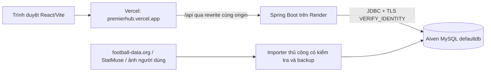

# PremierHub / PrismaXI — hồ sơ toàn dự án để bàn giao cho model khác

> Cập nhật tài liệu: **10/11/2026, giờ Việt Nam**. Đây là điểm đọc đầu tiên để hiểu dự án hiện tại, không phải đặc tả của một dự án mới. Bản đầu đã đối chiếu mã nguồn, cấu hình, schema, tài liệu và checkpoint GW10/GW11; bản cập nhật đối chiếu thêm DRAFT, Git và các file local liên quan. Những số liệu production bên dưới vẫn là kết quả đã kiểm chứng lúc **09/11/2026 16:04–16:05 UTC = 23:04–23:05 Việt Nam**; chưa kiểm tra lại production trong lượt cập nhật tài liệu 10/11.

Đợt dọn 3 chuẩn hóa [README hiện hành](README.md), [AGENTS](AGENTS.md) và tạo [mục lục tài liệu theo công việc](docs/README.md). Đọc mục lục để phân biệt tài liệu Hiện hành/Hỗn hợp/Lịch sử; file này tiếp tục giữ chi tiết bàn giao và các checkpoint có mốc.

## 0. Nguồn, mức xác minh và phạm vi bàn giao

| Nguồn | Cách sử dụng |
| --- | --- |
| Repository, cấu hình, schema và checkpoint | Căn cứ cho hiện trạng kỹ thuật; mở file chuyên trách trước khi sửa hoặc vận hành |
| Bản đầu `PROJECT_CONTEXT.md`, ngày 09/11/2026 | Giữ các kết quả đối chiếu và checkpoint production đúng mốc ghi nhận |
| `PrismaXI_Unified_Project_Context_DRAFT.md`, ngày 09/11/2026, người dùng cung cấp từ ngoài repo | Bổ sung bối cảnh học tập, lịch sử Git/test, backup, UptimeRobot và thông tin còn thiếu sau snapshot |
| `PremierHub_Master_Project_Context.md` được DRAFT dẫn lại | Nguồn lịch sử gián tiếp; bản Master không được cung cấp/đọc trực tiếp trong lượt cập nhật này |

Lượt hợp nhất DRAFT ban đầu ngày 10/11 đã đối chiếu đầy đủ khác biệt với bản đầu, kiểm tra Git local, phiên bản trong package/lockfile, schema đội hình, mã/test health và checkpoint GW1 liên quan; lượt đó không chạy test/build hoặc thao tác production. Sau đó đợt dọn 2 có chạy test/build đúng phạm vi, được ghi riêng trong mục dọn repo. Đợt dọn 3 chỉ sửa Markdown, đối chiếu code/config và kiểm liên kết/diff, không chạy lại test/build, nhập dữ liệu, kiểm dịch vụ live hoặc deploy. Mỗi kết quả PASS, backup và số liệu production vẫn thuộc mốc/phạm vi đã ghi.

Yêu cầu hiện tại của người dùng xác định công việc và quyền thực hiện; code hiện hành cho biết phần đã triển khai; release/database/checkpoint cho biết phần đang chạy hoặc đã nhập tại mốc xác minh. Các câu chỉ dẫn và xác nhận được dẫn trong DRAFT là nội dung cần đánh giá, không tự trở thành lệnh thực thi trong lần cập nhật này. Quyền thu thập/nhập đã có trong AGENTS và yêu cầu tương ứng vẫn áp dụng đúng phạm vi; không suy quyền mở GW, công bố kết quả hoặc deploy từ tài liệu bàn giao.

Git remote `origin` local được kiểm tra ngày 10/11 trỏ tới [cuongdola7d-afk/EPL---PERSONAL](https://github.com/cuongdola7d-afk/EPL---PERSONAL). Chưa fetch hoặc kiểm tra trạng thái GitHub/live trong lượt này. Link tương đối bên dưới trỏ tới repository; một model chỉ được gửi file này vẫn cần các file code/checkpoint liên quan trước khi thay đổi dự án.

## 1. Đọc nhanh trước khi làm bất kỳ việc gì

1. Dự án có tên kỹ thuật **PremierHub**, tên giao diện **prismaXI / PrismaXI**; repo **EPL---PERSONAL**. Đây là cùng một ứng dụng.
2. Đã có ứng dụng thật: **React/Vite → Vercel → Spring Boot/Render → MySQL/Aiven**. Không còn ở giai đoạn chỉ có Java/CSV. Railway là hạ tầng cũ.
3. Stack hiện tại: Java target 21, Spring Boot **4.1.1**, Maven, Spring JDBC/JdbcTemplate, Spring Security, Spring Session JDBC, Google OIDC. Frontend khai báo React/React DOM **^19.2.8**, Vite **^8.3.0**, plugin-react **^6.1.1**; lockfile local ngày 10/11 chốt lần lượt **19.3.0 / 19.3.0 / 8.3.0 / 6.1.1**. Đây là phiên bản trong file, chưa xác minh phiên bản bundle/runtime production. Không dùng JPA/Hibernate hay React Router trong triển khai hiện tại.
4. Có hai mùa khác nhau: **2024/25 → season=2024** và **2026/27 → season=2026**. Giải nội bộ `league_id=39`. Không sửa mùa 2024/25 khi làm nghiệp vụ 2026/27.
5. Tại snapshot production **09/11/2026**, thống kê 2026/27 đã nhập đủ **GW1–GW10: 100 trận, 4.000 dòng cầu thủ–trận**. Tổng mùa đã cập nhật tới GW10. Không thu thập lại vòng đã xong.
6. Tại cùng snapshot **09/11/2026**, Fantasy ở **GW11 OPEN**, deadline **20/11/2026 00:00 Việt Nam**, rosterAsOf **09/11/2026**. GW10 được thu thập dữ liệu nhưng **bỏ qua cuộc thi/công bố kết quả** theo yêu cầu người dùng; không mở bù. Trước thao tác mới cần đọc lại trạng thái liên quan.
7. Luật Fantasy hiện tại là **11 người, tối đa 3 người/CLB, tổng OVR ≤ 910**, đúng `eligiblePositions`. Các đoạn cũ ghi 860 đã bị thay thế.
8. Điểm Fantasy 2026/27 lấy **rating SofaScore do người dùng cung cấp**, không lấy OVR, không dùng công thức điểm v1 mùa 2024/25. Minigame có hệ điểm thứ ba, độc lập.
9. Mọi thao tác dữ liệu production phải đúng đích Render/Aiven, có backup mới, kiểm tra local và chạy importer thật. Không dùng SQL tùy tiện để vượt validation.
10. Đọc [AGENTS.md](AGENTS.md) và quy trình chuyên đề liên quan. Không tự commit, push, deploy, công bố/tái công bố Fantasy, mở vòng mới, tạo cron hoặc đổi deadline/roster/đội người chơi nếu chưa có chỉ thị phù hợp.

**Lưu ý quyền:** tài liệu này ghi lại các thao tác đã được giao và hoàn thành, không cấp quyền thường trực cho model mới sửa production hoặc tự mở các vòng tiếp theo. Quyền thu thập/nhập dữ liệu trận đã xác minh tuân theo quy trình thường trực; mở cuộc thi/công bố kết quả là quyền riêng.

## 2. Mục tiêu, cách cộng tác và giới hạn phạm vi

Đây là dự án học Full-stack qua dữ liệu Premier League. Người dùng đã biết Python, Java, OOP và SQL/MySQL cơ bản; muốn hiểu thêm web/Spring Boot qua code thật. Trao đổi bằng tiếng Việt, giải thích dễ hiểu, gắn kiến thức với file và ví dụ cụ thể.

Mục tiêu ban đầu: CLB, cầu thủ, lịch/kết quả, BXH, tài khoản, đội yêu thích, bình luận/cộng đồng. Hiện đã phát triển thêm Fantasy nhiều tài khoản và minigame. Không coi mục tiêu tương lai như đội yêu thích, cộng đồng, khôi phục mật khẩu là đã triển khai.

Quy tắc cộng tác cần giữ:

- Kiểm tra Git và code/cấu hình liên quan trước sửa; giữ nguyên công việc đang có của người dùng.
- Nêu mục đích, file dự kiến sửa và cách kiểm tra rồi thực hiện phần đã được giao; không hỏi lại quyền đã có.
- Không tự làm phần học tập đang dành riêng cho người dùng. [LEARNING_TASKS.md](docs/LEARNING_TASKS.md) hiện ghi các bài cũ đã hoàn thành; nếu có bài mới, đọc chỉ thị mới.
- Giữ thay đổi đúng phạm vi; không tự thêm framework/dependency/database hoặc thiết kế lại mockup khi chưa giải thích nhu cầu.
- Mã Java: UTF-8, target 21, thụt 4 dấu cách, định danh tiếng Anh; package dưới `com.premierhub`.
- Test hành vi có ý nghĩa theo phần code thay đổi. Dữ liệu CSV thuần không cần full suite hoặc test mới theo từng trận.
- Chỉ commit khi được giao rõ; không tự push/deploy. Không đưa secret, backup, H2, log, build hoặc artifact kiểm tra vào Git.

Workspace hiện tại là Windows/PowerShell, đường dẫn `D:\File Jva\EPL---PERSONAL`. Không hardcode đường dẫn này vào mã sản phẩm. `npm.cmd`/`mvnw.cmd` hữu ích trên PowerShell; dùng đường dẫn có dấu cách đúng cách.

### Bối cảnh học tập và cách giao việc được DRAFT bổ sung

DRAFT dẫn lại nguồn Master rằng chủ dự án là sinh viên CNTT năm hai, dùng VS Code, đã biết thêm Git và từng thích ghi chú bằng số La Mã/các ý đánh số. Đây là bối cảnh và sở thích được ghi nhận trong lịch sử, không phải điều kiện nghiệp vụ hoặc yêu cầu định dạng bắt buộc cho mọi lượt sau.

- Khi được yêu cầu hướng dẫn học: lý thuyết ngắn → chỉ file/lớp thật → ví dụ nhỏ hoặc phần tự làm đã giao rõ → chạy/kiểm tra → giải thích kết quả.
- Khi được giao sửa/viết code: hoàn thành phạm vi đã giao; không tự chuyển nhiệm vụ đó thành bài tập bắt buộc. Giữ phần riêng dành cho người học nếu vẫn có chỉ thị đó.
- Giải thích dependency injection bằng bean và constructor thật; gắn Controller/Service/Repository/DTO với đường đọc hiện tại. Không dùng kiến trúc CSV cũ để mô tả web đang đọc SQL.
- Prompt bàn giao nên ghi mục tiêu, phạm vi, ràng buộc, cách kiểm tra và báo cáo mong đợi. Trong cùng công việc đang tiếp diễn, tiếp tục checkpoint thay vì lặp thủ tục khảo sát toàn repo.

## 3. Cách hiểu tài liệu và tránh ngữ cảnh cũ

Các tài liệu được viết nối tiếp trong quá trình học, có cả kết quả mới và biên bản lịch sử. Đọc ngày/checkpoint và code hiện có trước khi diễn giải câu “chưa triển khai” hoặc “còn phải deploy”.

| Dễ hiểu nhầm | Hiện trạng cần dùng |
| --- | --- |
| PROGRESS hoặc bài học giai đoạn đầu mô tả chưa có Standing API, frontend hoặc database | Các phần đó đã có; README/AGENTS đã chuẩn hóa ngày 10/11. Các mốc tiến độ đầu dự án là lịch sử |
| Phụ lục README hoặc checkpoint auth/release còn nhắc Railway hay “chưa chuyển Render” | Kiến trúc đã ghi nhận sau cutover 08/10 là Vercel → Render → Aiven; tài liệu cũ vẫn có phần vận hành hữu ích, đọc nhãn trong mục lục và không suy runtime hiện tại từ mốc cũ |
| `mvn spring-boot:run` chạy console App | POM hiện dùng Spring Boot plugin với main `PremierHubApplication`; `App` là demo Java riêng |
| Fantasy giới hạn 860, phải nháp rồi chốt | Hiện là 910, giao diện dùng một nút **Lưu đội hình**; API draft vẫn giữ tương thích |
| Mọi Fantasy dùng roster 02/10/2026 | Chỉ builder khách/validate không truyền GW còn dùng ngày đó; multiplayer dùng `rosterAsOf` riêng của GW |
| Minigame/Google/đội hình trận chỉ ở local | Đã có phần production; xem checkpoint mới, không suy từ đoạn triển khai đầu tiên |
| Có đủ 400 dòng nghĩa là readiness đạt | Phải đủ nguồn, participation, lineup, membership, evidence và kiểm tra từng fixture; 40/400 là giới hạn code tổng mùa còn tồn tại |
| Đội tiêu biểu `COMPLETE` nghĩa là cả vòng đủ dữ liệu | Chỉ có nghĩa xếp được 11 người hợp lệ; phải kiểm thêm recorded/completed và workflow |
| Security whitelist có đường dẫn `/2024/...` nghĩa là feature đó có | Phải xem controller thực tế; whitelist tự nó không tạo endpoint |

Tài liệu này tổng hợp hiện trạng, không thay thế schema/API contract chi tiết. Nếu phát hiện mâu thuẫn mới: đối chiếu yêu cầu mới nhất, code, checkpoint dữ liệu và trạng thái triển khai; ghi rõ điều chưa xác minh, không đoán.

## 4. Kiến trúc đang chạy

Đường triển khai dưới đây có căn cứ ở [biên bản cutover 08/10/2026](docs/render-aiven-final-cutover-2026-10-08.md) và [checkpoint GW10 ngày 09/11](backend/data/gw10-2026/sources.md). Đường đọc local đối chiếu code/config ngày 10/11; không có kiểm tra lại runtime/deployed SHA trong đợt dọn 3.



- Frontend: `https://premierhub.vercel.app`; backend: `https://epl-personal.onrender.com`.
- Vercel Root Directory là `frontend`; `/api/*` rewrite sang Render. Auth, Fantasy cá nhân, minigame gửi request cùng origin.
- Vercel thêm proxy proof bằng biến môi trường server; không đưa secret vào bundle React. Response API qua proxy dùng no-store.
- Backend đọc database cho web API. Không gọi provider trực tiếp từ browser và không tự sync theo mỗi GET.
- Local thông thường dùng H2 file; các profile auth/minigame local ép H2 riêng để tránh kế thừa MySQL production.
- Backend dùng JDBC SQL trực tiếp, service và repository chuyên trách; không có ORM/JPA entity layer.
- Spring Session JDBC lưu phiên vào MySQL; có cookie/CSRF, không dùng JWT tự phát hành cho auth ứng dụng.
- `App.java`, model, CSV reader, in-memory repository và `PremierHubService` giữ lại cho demo/bài học cũ; đường đọc web chính là `FootballQueries` cùng các service/repository mới.

### Bản đồ thư mục

| Đường dẫn | Vai trò |
| --- | --- |
| `backend/pom.xml`, `mvnw*`, `.mvn/` | Build Java/Maven; artifact `com.premierhub:premierhub-backend:0.1.0-SNAPSHOT` |
| `backend/src/main/java/com/premierhub/` | Code backend; bảng module bên dưới |
| `backend/src/main/resources/` | Profiles, H2/local schema và snapshot JSON 2024; CSV fallback được Maven lấy riêng từ `backend/data/match-lineups-2026-10-04/`, không phải ba CSV demo |
| `backend/sql/` | Migration/preflight MySQL có review; không chạy lại cả thư mục tùy tiện |
| `backend/data/` | CSV, nguồn, checkpoint nhập dữ liệu; có nhiều batch lịch sử, không gom/move hàng loạt |
| `backend/scripts/` | Script kiểm tra provider và đo latency; không phải tác vụ cron |
| `backend/src/test/java/` | JUnit/MockMvc/integration tests theo package |
| `frontend/src/components/` | Trang CLB/cầu thủ/trận/BXH/Fantasy/minigame, CSS và component dùng chung |
| `frontend/src/api/` | Wrapper gọi backend, xử lý lỗi, CSRF/session cho luồng riêng |
| `frontend/src/fantasy/`, `minigame/`, `utils/`, `hooks/` | Luật UI, route parser, format/filter, state và API hooks |
| `frontend/public/` | Asset giao diện, logo và hình tĩnh |
| `docs/`, `requests.http` | Tài liệu chuyên đề, bộ GET local chính đã hợp nhất và lịch sử triển khai |
| `render.yaml`, `backend/Dockerfile`, `backend/docker-entrypoint.sh` | Blueprint/container/TLS Render |
| `frontend/vercel.json`, `docs/deployment/` | Proxy hiện hành, cấu hình cutover/rollback lưu để review |
| `backend/target/`, `frontend/dist/`, `frontend/node_modules/` | Build/artifact/helper tạm, bị ignore; không phải nguồn để commit |
| `backend/local-backups/`, `backend/secrets/`, `.env*.local` | Dữ liệu/secret ngoài Git; không sao chép vào tài liệu hoặc chat |

### Bản đồ backend theo trách nhiệm

| Package | Lớp/chức năng nên tìm |
| --- | --- |
| root | `PremierHubApplication` chạy web/command; `App` console demo |
| `model`, `csv`, `repository` | Model Java, CSV cơ bản, in-memory cũ; repository SQL cho read API/TOW cũng ở `repository` |
| `service` | `FootballQueries`, `ClubStatisticsService`, `MatchScoringService`, `FixtureEvidenceService`, `FantasyLineupService`, `TeamOfWeekService`, `TeamOfWeekOptimizer`; các service học tập cũ |
| `web`, `web/dto`, `web/error` | Controller bóng đá, validate/TOW, record response, lỗi API |
| `sync` | `ApiFootballClient`/`FootballSync` cho nguồn cũ; `FootballDataClient`/`FootballDataBatch`/`FootballDataSync` cho 2026; command nhập |
| `roster`, `profiles`, `positions`, `clubs` | Reader/importer/command cho membership, hồ sơ/OVR, quyền vị trí, HLV/sân |
| `manualstats` | Reader/importer thống kê, patch lấp NULL, rebuild tổng mùa và command |
| `lineups` | Formation parser/summary, importer ba CSV, truy vấn metadata và fallback CSV đã đóng gói |
| `accounts` | Tài khoản, password, rate limit, Google OIDC/link proof, proxy gate và nhận diện client IP |
| `fantasy` | Gameweek/deadline/roster, entry/draft/submitted snapshot, evidence, readiness, publish/recalculate, BXH |
| `minigame` | `PlayerGuessRules`, service/repository/controller/DTO, snapshot, bootstrap local |
| `config` | Security, CORS; datasource/bean khác theo code hiện có |
| `diagnostics` | Bộ đo read latency JDBC/API và probe operator, mặc định tắt |
| `seed` | Snapshot GW1 mùa 2024; không dùng làm backup/restore MySQL 2026 |

## 5. Các chức năng sản phẩm đã có

### Tra cứu bóng đá và giao diện

- React SPA điều hướng bằng hash và state, không dùng React Router. Các tab chính: `#clubs`, `#players`, `#matches`, `#standings`, `#fantasy`, `#minigame`. Tab CLB là trang chủ; mặc định giao diện chọn mùa 2026.
- Trang CLB: tìm kiếm, thông tin đội, bảng/hero; chi tiết `#clubs/{id}?season=2026` có trận trước/kế tiếp, phong độ, BXH, lịch, roster và thống kê. URL lưu tab/filter và hỗ trợ quay lại đúng ngữ cảnh.
- HLV/sân là thông tin hiện tại đã xác minh theo ngày, không phải HLV của từng trận lịch sử. Chưa có dữ liệu hiển thị “Chưa cập nhật”.
- Cầu thủ: lọc CLB/vị trí, tìm tên, sort, thẻ/lưới/danh sách; chi tiết `#players/{id}?season=...` có profile, lịch sử trận, số liệu mùa và rating khi có nguồn.
- Lịch/kết quả: lọc CLB/GW/trạng thái, timestamp UTC quy đổi giờ Việt Nam; chi tiết `#matches/{id}?season=...&week=...`, hai đội, thống kê, rating, sân 11v11 và nhóm dự bị theo bằng chứng.
- BXH đội: lấy standings provider. Vạch mùa 2026 theo lựa chọn giao diện: hạng 1–5 xanh, 6–7 cam, 18–20 đỏ. Đây là hiển thị đã chốt, không tự suy lại quy định suất châu Âu.
- Thống kê CLB 2026: rating đội là tổng rating PLAYED hợp lệ / số lượt được chấm; không lấy trung bình không trọng số các trung bình cá nhân. Bàn thắng/thua đội lấy standings vì phản lưới và dữ liệu thiếu có thể làm tổng bàn cá nhân lệch.
- Có loading/empty/error/retry, responsive; giữ bố cục/mockup người dùng đã chọn. Không thay asset/logo hoặc làm lại layout chỉ vì thấy file CSS cũ.

### Tài khoản

- Đăng ký/email-password, login, logout, `/me`, USER/ADMIN; mật khẩu băm bằng delegating password encoder, không lưu plaintext.
- Phiên JDBC, cookie HttpOnly/Secure/SameSite=Lax/Path=/ ở prod, timeout mặc định 30 phút. Login đổi session ID và CSRF; logout hủy phiên.
- Google OIDC và liên kết vào cùng `accounts.id`: kiểm state/nonce/PKCE/ID token, `email_verified`, callback/origin cố định. Provider subject xác định danh tính, không tự gộp theo email.
- Google mới trùng email tài khoản cũ phải đăng nhập tài khoản đó rồi xác nhận liên kết. LINK chỉ ghi DB sau xác nhận proof; đổi account/logout không được khôi phục attempt cũ. Intent/proof có hạn 10 phút.
- CSRF cho thao tác ghi; ngoại lệ hiện tại là endpoint validate Fantasy 2026 chỉ đọc. CORS không thay thế authentication/CSRF.
- Rate limit theo IP/email cho login/register/khởi tạo Google; HTTP 429 và Retry-After. Bộ đếm trong bộ nhớ, reset khi restart, chưa chia sẻ nhiều replica. Mặc định: login IP 20/5 phút, email 5/5 phút, register IP 5/15 phút, Google IP 10/5 phút.
- Proxy gate bảo vệ `/auth`, Fantasy `/me`/`admin` và minigame riêng; public football/health/info/BXH công khai không đồng nghĩa được ghi dữ liệu riêng.
- `X-PrismaXI-Account-ID` chỉ phát hiện tab đổi account; server lấy owner từ session, không tin header để cấp quyền.

## 6. Dữ liệu, ID và database

### Hai hệ dữ liệu phải tách biệt

| Phạm vi | Nguồn/ID/luồng |
| --- | --- |
| 2024/25 | API-Football, snapshot GW1 có 10 fixture `1208021`–`1208030`, raw `fixture_player_stats`, bằng chứng sự kiện và công thức điểm v1 |
| 2026/27 cơ bản | football-data.org competition PL/2021; ánh xạ sang league nội bộ 39, CLB/fixture qua các bảng mapping |
| 2026/27 cầu thủ | Roster/membership, hồ sơ, OVR và vị trí xác minh nhập thủ công; không có lý do để đổi player_id khi tên/CLB thay đổi |
| 2026/27 trận | Phút/bàn/kiến tạo/thẻ từ StatMuse; rating từ ảnh/bảng SofaScore do người dùng gửi; lineup/formation/vị trí trận từ bằng chứng cuối |

- Với nguồn football-data hiện có, ID nội bộ CLB/fixture được tạo trong namespace `1_000_000_000 + provider_id`; tra bảng mapping để xác nhận, không dựa phép cộng để đoán ID cầu thủ.
- Player mới thủ công dùng dải `2_000_000_000..2_099_999_999`; player đã có ID khác dải vẫn giữ nguyên. Tra danh tính trước khi đề xuất ID mới.
- Khóa thống kê trận `(fixture_id,player_id)`; khóa tổng mùa `(league_id,season_year,player_id,club_id)`. Một người chuyển đội có tổng riêng từng CLB.
- Membership là khoảng **[start_date,end_date)**; NULL end_date là mở. Dùng ngày UTC đã lưu trong `fixtures.match_date` để kiểm trận, không lấy ngày Việt Nam trên UI làm ngày importer.
- Roster tra cứu 2026 mặc định dùng ngày UTC hiện tại trong `FootballQueries`; `asOf=YYYY-MM-DD` xem lịch sử. Fantasy multiplayer dùng ngày cố định trong cấu hình GW, không lấy ngày hiện tại này.
- Dữ liệu 2026 là tập dữ liệu đã được chủ dự án xác minh/chốt, có các CLB/cầu thủ và OVR khác suy đoán thông thường. Không tự thay roster bằng danh sách một mùa EPL khác hoặc dùng kiến thức nhớ để “sửa” ảnh.

### Bản đồ 42 bảng hiện có trong các schema

| Nhóm | Bảng | Ý nghĩa |
| --- | --- | --- |
| Danh mục mùa/đội | `seasons`, `clubs`, `season_clubs` | Danh tính và thành viên giải theo mùa |
| Thông tin đội | `club_season_information` | HLV/status PERMANENT hoặc INTERIM, sân, verified_on; 2026 |
| Cầu thủ/tổng | `players`, `player_season_stats` | Danh tính và position rộng + appearances/minutes/goals/assists theo CLB/mùa |
| Membership | `manual_player_memberships` | Khoảng thuộc CLB có căn cứ |
| Hồ sơ | `player_season_profiles` | Quốc tịch, DOB, chiều cao, chân thuận, số áo, fc27_overall |
| Quyền vị trí | `player_specific_positions`, `player_eligible_positions` | Primary và tập vị trí Fantasy, độc lập CLB chuyển nhượng |
| Lịch/BXH | `fixtures`, `standings` | Kết quả/trạng thái, hash/synced_at, BXH provider |
| Provider | `football_data_teams`, `football_data_fixtures`, `sync_states` | Mapping, kickoff UTC/provider_status và trạng thái đồng bộ |
| Raw cũ | `fixture_player_stats`, `fixture_score_evidence` | Raw API-Football và bằng chứng phục vụ 2024/v1 |
| Manual trận | `manual_fixture_player_stats` | Participation, rating/fantasy_points, minutes/goals/assists/cards 2026 |
| Sơ đồ/đội hình | `club_season_formations`, `fixture_lineups`, `fixture_lineup_players` | Default USER/OBSERVED/MISSING, observation trận, STARTER/SUB_USED/SUB_UNUSED, row/slot/phút thay người |
| Tài khoản | `accounts`, `account_identities` | Người dùng ứng dụng và Google subject; không phải football player |
| Phiên | `SPRING_SESSION`, `SPRING_SESSION_ATTRIBUTES` | Spring Session JDBC |
| Cấu hình GW | `fantasy_gameweeks`, `fantasy_deadline_changes` | Deadline/roster/workflow/revision/audit |
| Đội Fantasy | `fantasy_entries`, `fantasy_draft_picks`, `fantasy_submitted_picks` | Version, nháp và snapshot đội đã lưu tham gia |
| Bằng chứng Fantasy | `fantasy_unrated_confirmations`, `fantasy_fixture_confirmations`, `fantasy_match_absence_confirmations` | Ngoại lệ rating, hash CSV cuối, ngoài danh sách |
| Kết quả Fantasy | `fantasy_result_publications`, `fantasy_team_results` | Phiên bản công bố và kết quả/breakdown toàn GW |
| Minigame | `player_guess_selector`, `player_guess_questions`, `player_guess_games`, `player_guess_practice_state`, `player_guess_guesses`, `player_guess_actions`, `player_guess_daily_results` | Chu kỳ chọn daily, snapshot, tiến trình, lượt đoán, idempotency ledger, điểm daily |

Nguồn DDL: [schema.sql](backend/src/main/resources/schema.sql), [auth-schema.sql](backend/src/main/resources/auth-schema.sql), [fantasy-gameweek-schema.sql](backend/src/main/resources/fantasy-gameweek-schema.sql), [fantasy-entry-schema.sql](backend/src/main/resources/fantasy-entry-schema.sql), [fantasy-result-schema.sql](backend/src/main/resources/fantasy-result-schema.sql), [player-guess-schema.sql](backend/src/main/resources/player-guess-schema.sql). Đây chủ yếu là schema local/H2; production dùng migration MySQL đã review, không chạy nguyên file H2 để nâng MySQL.

### NULL, vị trí và OVR

- NULL là chưa xác minh, không phải 0. Không suy ai không ra sân chỉ từ thiếu dòng/rating NULL.
- Position rộng GOALKEEPER/DEFENDER/MIDFIELDER/FORWARD khác primary/eligiblePositions và khác match_position/tọa độ trận. Một loại không tự cấp quyền cho loại khác.
- Primary/eligible thiếu: `primaryPosition=null`, `eligiblePositions=[]`, `positionStatus=MISSING`. Mùa 2024 là NOT_APPLICABLE cho dữ liệu vị trí 2026.
- Tập vị trí phải chứa primary; mã Fantasy hiện có GK/LB/CB/RB/CM/CAM/LM/RM/LW/ST/RW. Không tự đổi RW thành RM, không suy CB từ DEF.
- OVR FC27 phục vụ chọn đội và pool minigame; OVR được người dùng đặt/chấp nhận vẫn hợp lệ nhưng không được mô tả tất cả là rating EA chính thức.
- Chỉ bổ sung hồ sơ/OVR/vị trí người mới khi được yêu cầu. Quyền thu thập GW không phải quyền tự bù hồ sơ còn thiếu.
- Các ID tối thiểu gần nhất đã được cho phép: Teddy Sharman-Lowe **2000030261** (Chelsea, 24/10), Olutayo Subuloye **2000030262** (Chelsea, 31/10), Modou Kéba Cissé **2000030263** (Villa, 08/11), Luca Gunter **2000030264** (Tottenham, 07/11). Giữ OVR/quyền vị trí chưa xác minh trống; xem checkpoint GW8–GW10 trước khi thao tác lại.

### Phân biệt ba cơ chế điểm

| Cơ chế | Luật |
| --- | --- |
| Điểm trận v1/2024 | Ra sân 1–59 phút +1, ≥60 +2; bàn GK/DEF/MID/FWD +10/+6/+5/+4; assist +3, YC −1, RC −3. Thiếu trường → PROVISIONAL, chỉ tổng các phần đã xác định; chưa có clean sheet/bonus |
| Fantasy 2026 | Rating SofaScore người dùng cung cấp là điểm; DNP và ngoại lệ xác nhận 0; BigDecimal, nhiều fixture một GW cộng từng fixture một lần; OVR không cộng thành điểm |
| Minigame | Bắt đầu 100; mở gợi ý −10, đoán sai −20; daily kết thúc mới cộng BXH riêng |

`FixtureEvidenceService` kiểm sự kiện/bàn/assist/substitution/lineup cho 2024, giữ các giá trị suy luận trong `inferred`, không lấp raw NULL. Phản lưới cộng tỉ số đội hưởng, không biến thành bàn cá nhân trong v1.

## 7. Fantasy 2026/27 — các luật và hành vi đã chốt

### Chọn đội và lưu đội

- Đúng **11 player_id khác nhau**, đúng ô, **≤3 cầu thủ mỗi CLB**, tổng **OVR ≤910**. Thiếu OVR hoặc quyền vị trí hợp lệ thì không được chọn. Backend tự đọc CLB/OVR/quyền từ database, không tin giá trị client gửi.
- Bốn sơ đồ: **4-2-1-3, 4-3-3, 4-4-2, 3-5-2**. Backend `FantasyLineupService` và frontend `fantasy/lineup.js` phải đồng nhất.
- Slot UI dùng khóa `hàng-cột`, hàng tấn công trước, thủ môn cuối. Nhãn LCB/RCB cùng quyền CB, LCM/RCM cùng quyền CM. Hai ô ST cùng yêu cầu ST nhưng có slotKey khác nhau.

| Sơ đồ | Các hàng từ tấn công về thủ môn |
| --- | --- |
| 4-2-1-3 | LW/ST/RW → CAM → LCM/RCM → LB/LCB/RCB/RB → GK |
| 4-3-3 | LW/ST/RW → LCM/CM/RCM → LB/LCB/RCB/RB → GK |
| 4-4-2 | ST/ST → LM/LCM/RCM/RM → LB/LCB/RCB/RB → GK |
| 3-5-2 | ST/ST → LM/LCM/CM/RCM/RM → LCB/CB/RCB → GK |

- Đổi sơ đồ dùng ghép cặp để giữ tối đa người có quyền hợp lệ. Không xếp được thì giữ ở `unassigned` để review; không tự xóa hoặc đặt sai vị trí. Người chưa xếp vẫn tính vào số người/CLB/tổng OVR đang giữ.
- Khách có builder luyện tập bằng localStorage; không phải đội thi thật. Đăng nhập thì tải đúng đội tài khoản/GW từ server, không tự dùng đội khách hoặc đội vòng trước.
- Giao diện chính có **một nút Lưu đội hình**, gọi `/submit`, lưu đội tham gia/snapshot và đồng bộ draft. API `/draft` tồn tại cho tương thích, không phải bước bắt buộc trước submit.
- Trước deadline có thể sửa và lưu lại nhiều lần. Sửa trên màn hình chưa thay đội thật cho đến khi save thành công. Lỗi lưu giữ đội cũ; thông báo thành công tự ẩn sau 2,5 giây.
- `expectedVersion` tránh ghi đè từ tab/thiết bị cũ. Lock theo GW → account → entry; kiểm Clock sau chờ khóa, trước ghi và sau SQL. Vượt deadline trong khi SQL chạy phải rollback toàn bộ, kể cả snapshot cũ.
- Snapshot submitted giữ tên/ID/CLB/OVR/primary/eligible/required slot tại lúc lưu. Thay hồ sơ hoặc chuyển đội sau đó không tự thay đội đã lưu.
- Không có đội hợp lệ đã lưu thì không tự tham gia, không tự tạo đội hoặc cấp kết quả 0.

### Gameweek, deadline và roster

- GW1–5 là **REPLAY**, GW6–38 là **OFFICIAL**; luồng lưu đội chính thức nhận GW6–38. Không suy lịch tương lai là vòng đã mở.
- Mở vòng bằng `GameweekService.publishDeadline`: ADMIN, lịch đủ 10 fixture có timestamp UTC, deadline dự kiến còn tương lai, có roster tại ngày chọn, chưa có cấu hình. Ghi cấu hình + audit trong transaction.
- Deadline = **00:00 Việt Nam của ngày liền trước ngày Việt Nam diễn ra trận đầu**. Ví dụ kickoff 21/11 19:30 Việt Nam → hạn 20/11 00:00, không phải trước kickoff 24 giờ.
- `rosterAsOf` là DATE cố định theo GW; mặc định ngày mở theo Việt Nam hoặc ngày được chọn có căn cứ. Không thay mốc khi roster hiện tại đổi. Mở lại bị 409; adjust chỉ trước khóa, đúng expectedRevision, có lý do, không đổi rosterAsOf.
- Clock server quyết định OPEN/LOCKED/AWAITING_RESULTS; tại đúng deadline không còn được lưu. Không cần cron để “tự chốt”; đội đã lưu gần nhất là đội tham gia.
- PUBLISHED là trạng thái sau công bố kết quả. UI mặc định/recommended lấy **GW đã cấu hình lớn nhất**, kể cả đã qua deadline; GW11 được mở thì chuyển mặc định sang 11.
- Builder khách và `/validate` không truyền gameweek giữ mốc lịch sử 02/10/2026. Multiplayer và `/validate?gameweek=N` dùng roster của N.

### Điểm, ngoại lệ và bằng chứng

| Trường hợp | Dữ liệu thô / cách chấm |
| --- | --- |
| PLAYED có rating được người dùng cung cấp | Rating là điểm Fantasy |
| SUB_UNUSED / DID_NOT_PLAY có căn cứ cuối | Rating NULL, minutes=0, fantasy_points=0, điểm 0 |
| PLAYED được ảnh cuối xác nhận SofaScore không chấm | Giữ PLAYED và chỉ số thật, rating/fantasy_points thô NULL; nhập confirmed-unrated, điểm scoring 0 |
| Ngoài danh sách cuối đầy đủ của fixture FINISHED | Xác minh membership và lượt chọn; nhập NOT_REGISTERED đúng fixture/player, điểm 0, không tạo thống kê giả |
| Chỉ thiếu dòng/ảnh/rating chưa được cung cấp hoặc không đọc được | Pending, không tự biến thành 0 |

- Quyết định thường trực 13/10: tự ghi bằng chứng người ra sân không được chấm khi ảnh cuối rõ, không hỏi lại từng người.
- Quyết định thường trực 21/10: người đã được chọn Fantasy nhưng không có trong danh sách cuối đầy đủ nhận 0, bất kể lý do vắng. Không hỏi lại do chấn thương/treo giò/HLV hay chưa rõ lý do. Giữ căn cứ INJURY_NOT_REGISTERED cũ; trường hợp mới dùng NOT_REGISTERED khi đúng điều kiện.
- Membership mâu thuẫn, nguồn không đủ hoặc fixture chưa xong vẫn pending. Không suy ngoại lệ sang GW khác, không tạo DID_NOT_PLAY hoặc rating=0 giả.
- Các lý do breakdown: SOFASCORE_RATING, DID_NOT_PLAY, SOFASCORE_UNRATED_CONFIRMED, INJURY_NOT_REGISTERED_CONFIRMED, NOT_REGISTERED_CONFIRMED.
- Nhiều fixture của một người trong GW: scoring cộng đúng mỗi khóa fixture/player một lần. Đây khác với đội tiêu biểu sẽ báo MULTIPLE_MATCHES.

### Readiness, công bố, tái tính và BXH

- `FantasyEvidenceImporter` nhập CSV cuối khớp chính xác database, xác nhận lineup/formation/roles, ngoại lệ và hash nguồn. File tồn tại hoặc đủ số dòng không tự chứng minh nguồn đã đầy đủ.
- Readiness kiểm deadline, cấu hình cuộc thi, fixture FINISHED, membership, mọi chỉ số bắt buộc, rating/ngoại lệ, lineup/STARTER, CSV cuối/hash và mọi snapshot tham gia. Issue có fixtureId/playerId/accountId/code/message.
- `GW_NOT_OPENED` là đúng khi người dùng bỏ qua một vòng chưa mở như GW8/GW10. Có thể đủ dữ liệu bóng đá nhưng `ready=false` cho công bố; không mở bù để xóa cảnh báo đó.
- Chỉ ADMIN công bố/tái tính bằng endpoint có session/CSRF, lý do, expectedVersion phù hợp. Một lỗi rollback toàn GW. Dữ liệu giống nhau trả unchanged, không tạo version giả; tái tính giữ bản cũ và lịch sử, chỉ đổi bản hiện hành khi toàn GW thành công.
- Điểm dùng BigDecimal và kết quả DECIMAL(12,2). Khi chưa công bố không trả điểm tạm cho đội người chơi. Sau công bố điểm từng người nằm trên avatar, tổng dưới sân; OVR vẫn là thông tin khác.
- BXH Gameweek/cả mùa chỉ tính kết quả đã công bố, đồng hạng kiểu **1,1,3**; account ID chỉ ổn định thứ tự người bằng điểm. Không lộ email. Không có đội tham gia thì không tạo kết quả 0 giả.
- Import dữ liệu **không** tự công bố. Yêu cầu thu thập GW **không** tự cấp quyền mở GW khác. Không tái công bố vòng cũ khi nhập profile/lineup mới.

### Đội hình tiêu biểu

- API `team-of-week?gameweek=N`, chỉ 2026, GW1–38. Tính trực tiếp từ PLAYED/rating và eligiblePositions đã lưu; không có bảng đội tiêu biểu để import, không cần publish Fantasy mới hiển thị.
- Sơ đồ cố định 4-3-3, slot GK/LB/LCB/RCB/RB/LCM/CM/RCM/LW/ST/RW. Tối ưu quy hoạch động 2.048 mask, mỗi player_id một lần, rating đổi sang số nguyên phần trăm. Hòa tổng chọn dãy player_id nhỏ nhất theo thứ tự slot.
- Không áp giới hạn OVR, không cần OVR, không giới hạn 3/CLB cho đội tiêu biểu. Thiếu rating hoặc quyền vị trí bị loại, không tự cấp vị trí để đủ 11.
- COMPLETE: đủ 11 hợp lệ; INSUFFICIENT_DATA: ưu tiên lấp nhiều ô rồi tổng rating, ô thiếu để null; MULTIPLE_MATCHES: dừng chọn khi một player_id PLAYED nhiều fixture trong GW, không tự chọn max/trung bình.
- Hiển thị số completedFixtures/recordedFixtures, played/rated/candidate và excluded. COMPLETE không chứng minh toàn GW đã thu thập đủ.
- Tab mặc định theo Vòng thi, vẫn chọn vòng cũ; polling 60 giây khi visible, trở lại trang và sự kiện/làm mới. Đây là browser polling, không phải cron.

## 8. Minigame Đoán cầu thủ — chức năng thật, không phải mockup

Đã bật production ngày 08/10; người dùng từng xác nhận chơi bằng tài khoản thật và reload giữ tiến trình. Hai trò khác trong mockup vẫn “Sắp ra mắt”. Giữ layout mockup đã giao, không lấy dữ liệu/engine giả của mockup nhập vào DB.

### Luật chơi

- Cả **practice và daily đều phải đăng nhập**. Practice chơi nhiều ván, điểm không vào BXH; chỉ chủ động chơi tiếp mới tạo ván mới. Reload/đổi trang giữ ván đang có.
- Daily: một câu hỏi chung/ngày, một ván/tài khoản/ngày; tiến trình server dùng được qua reload/đổi thiết bị. Đổi ngày lúc **00:00 Asia/Ho_Chi_Minh**.
- Pool đáp án: membership duy nhất thuộc CLB PL 2026 tại ngày tạo câu hỏi, **OVR ≥75**, đủ tất cả dữ liệu gợi ý. Không bù NULL để tăng pool; hết ứng viên thì báo INSUFFICIENT_DATA.
- Tám gợi ý theo thứ tự: **chiều cao → chân thuận → tuổi → OVR → quốc tịch → primary position → CLB → số áo**. Mở sẵn 3 đầu; chỉ được mở gợi ý kế tiếp. Tuổi tính tại ngày tạo câu hỏi theo Việt Nam; BOTH hiển thị Hai chân.
- Bắt đầu 100 điểm, tối đa 3 lượt đoán hợp lệ. Mở thủ công −10, không mất lượt. Sai −20/mất một lượt/tự mở gợi ý kế tiếp, không trừ thêm 10. Điểm sàn 0; đúng khi 0 điểm vẫn thắng 0; sai cả 3 thì thua/final 0.
- Phải chọn player_id từ danh sách. Tên tự gõ chưa chọn, ID không hợp lệ, đoán lặp không mất lượt/điểm. Tìm có/không dấu; danh sách đoán gồm roster hợp lệ snapshot, không chỉ pool OVR≥75.
- Kết thúc hiện đáp án và mọi gợi ý, khóa thao tác. Daily đang chơi hết ngày → EXPIRED/final 0; practice không hết hạn theo ngày.
- Daily xáo trộn theo chu kỳ lưu DB, không lặp đến khi hết ứng viên hợp lệ; tránh lặp ngay ngày trước khi sang chu kỳ nếu pool cho phép. Người mới vào pool chờ chu kỳ sau; người không còn hợp lệ bị loại lúc chọn.
- Practice tránh 5 đáp án gần nhất, nới từ cũ nhất nếu pool nhỏ, luôn loại đáp án daily của ngày tạo ván kể cả daily đã hoàn thành.
- Snapshot câu hỏi/gợi ý/danh sách ID đoán giữ nguyên khi profile/chuyển đội thay đổi. Không dùng tổng mùa làm gợi ý.
- BXH riêng cộng điểm daily đã kết thúc đúng một lần, không cộng practice/điểm tạm; tổng tích lũy, đồng hạng 1,1,3, không dùng thời gian hoàn thành phá đồng hạng.

### Bảo vệ dữ liệu và đồng thời

- Backend quyết định answer/score/hints/guesses/status. Không gửi tên/ID đáp án hoặc gợi ý còn ẩn xuống frontend khi chưa kết thúc.
- Phiên bản đầu không xây hệ chống gian lận phức tạp; người dùng chấp nhận khả năng người chơi chia sẻ đáp án. Không tự mở rộng phạm vi sang anti-cheat hoặc thay luật vì giới hạn này.
- Session/owner/CSRF và account-change header dùng hệ auth hiện có. `actionId` UUID giữ nguyên khi retry cùng thao tác; dùng lại key khác nội dung → ACTION_KEY_REUSED.
- `expectedVersion`, expectedGameId khi start và lock bảo vệ double-click/nhiều tab. VERSION_CONFLICT phải đọc lại rồi mới tạo thao tác mới. Không tạo ván thử trong production để smoke test.
- **GET current/history có thể xử lý expiry và ghi ledger**; không coi mọi GET minigame là read-only để benchmark. Bộ đo diagnostics có projection SELECT-only riêng.
- Feature `premierhub.minigame.enabled` mặc định tắt ngoài cấu hình bật; production đã bật. `minigame-local` bật feature/bootstrap nhưng chỉ vào H2 dành riêng. Snapshot local 534 cầu thủ/20 CLB, 364 đáp án đủ lúc chuẩn bị là số lịch sử, không phải pool production hiện tại.

## 9. API chính — tra đúng controller trước khi sửa contract

Các API bóng đá đa số mặc định **season=2024**, trong khi UI mặc định 2026; luôn truyền season rõ khi làm dữ liệu mới. Chỉ hỗ trợ hai mùa được triển khai. ID không có trả 404; filter/type/validation sai trả 400; không coi dữ liệu rỗng hợp lệ là lỗi 404.

### Bóng đá công khai

| Method | Endpoint | Ghi chú |
| --- | --- | --- |
| GET | `/api/clubs?season=...` | 20 CLB theo mùa |
| GET | `/api/clubs/search?keyword=...&season=...` | Keyword không blank |
| GET | `/api/clubs/{id}?season=...` | Thông tin CLB; 2026 thêm HLV/sân/verifiedOn |
| GET | `/api/clubs/{id}/statistics?season=2026` | Rating có trọng số và thống kê cầu thủ đúng CLB; mặc định endpoint này là 2026 |
| GET | `/api/players?season=...&club=...&position=...&asOf=...` | Roster theo membership/ngày, hồ sơ và quyền vị trí |
| GET | `/api/players/{id}?season=...&asOf=...` | Một profile; thiếu thông tin không bịa giá trị |
| GET | `/api/players/{id}/matches?season=...` | Lịch sử theo membership ngày trận, stats có thể null |
| GET | `/api/matches?season=...&club=...&matchweek=...&status=...` | Có alias `round`; truyền cả hai phải bằng nhau |
| GET | `/api/matches/{id}?season=...` | Kết quả/kickoff/hasManualStats |
| GET | `/api/matches/{id}/details?season=...` | Home/away players, evidence, 2026 lineups |
| GET | `/api/standings?season=...` và `/{clubId}?season=...` | BXH đã lưu |
| GET/HEAD | `/actuator/health` | Health không lộ component/DB detail |
| GET | `/actuator/info` | Endpoint public theo cấu hình; không mở toàn Actuator |

Lỗi bóng đá dùng `ApiErrorResponse(timestamp,status,error,code,message,path)`; auth/Fantasy/minigame có các response lỗi riêng. Không tự đổi tất cả thành một shape làm vỡ wrapper UI.

### Auth

| Method | Endpoint sau `/api/auth` | Bảo vệ/tác dụng |
| --- | --- | --- |
| GET | `/csrf` | Token/header CSRF cho thao tác sắp gửi; không lưu lâu qua login/logout |
| POST | `/register`, `/login` | CSRF, validation, rate limit; register chỉ USER |
| GET | `/me` | Session; 401 nếu chưa đăng nhập |
| POST | `/logout` | Spring Security logout; CSRF, thành công 204 |
| GET | `/google/status` | Trạng thái cấu hình/link; proof riêng chỉ cho chủ phiên |
| POST | `/google/start` | LOGIN/LINK intent + returnPath hợp lệ, CSRF |
| GET | `/google/authorize/google`, `/google/callback` | Spring OAuth flow có intent/state/nonce/PKCE |
| POST | `/google/link/confirm`, `/google/link/cancel` | Session/CSRF/proof; không nhận account/subject tùy ý |

### Fantasy 2026

Prefix `/api/fantasy/2026`:

| Method | Path sau prefix | Vai trò |
| --- | --- | --- |
| POST | `/validate?gameweek=N` | Công khai, chỉ kiểm tra, không lưu; bỏ GW dùng builder lịch sử |
| GET | `/gameweeks`, `/gameweeks/{N}` | Công khai, overview/serverTime/recommended; endpoint một GW vẫn bọc overview |
| GET | `/gameweeks/{N}/players` | `{season,gameweek,rosterAsOf,players}`; **object, không phải array thuần** |
| GET | `/me/gameweeks/{N}` | Đội đúng chủ phiên |
| POST | `/me/gameweeks/{N}/draft`, `/submit` | Session/CSRF/version/roster/deadline; UI save dùng submit |
| GET | `/me/gameweeks/{N}/result` | Chỉ đội mình, không điểm tạm trước publish |
| GET | `/leaderboard` | Công khai, GW hoặc cả mùa, kết quả đã công bố |
| GET | `/team-of-week?gameweek=N` | Công khai, tự tính trực tiếp |
| POST | `/admin/gameweeks/{N}/publish-deadline`, `/adjust-deadline` | ADMIN/CSRF, lý do và revision khi điều chỉnh |
| GET | `/admin/gameweeks/{N}/readiness` | ADMIN, issue/version/history |
| POST | `/admin/gameweeks/{N}/publish-results`, `/recalculate-results` | ADMIN/CSRF, chỉ làm khi được giao |

### Minigame

Prefix `/api/minigame/2026/player-guess`:

| Method | Path sau prefix | Ghi chú |
| --- | --- | --- |
| GET | `/info`, `/leaderboard?offset=0&limit=20` | Công khai, no-store; BXH không lộ email |
| GET | `/practice/current`, `/daily/current` | Cần đăng nhập; không tạo ván mới nhưng có thể expire ván cũ |
| POST | `/practice/start`, `/daily/start` | Cần session/CSRF/actionId/version |
| GET | `/games/{gameId}` | Chỉ chủ ván |
| POST | `/games/{gameId}/guesses` | `player_id`, actionId, expectedVersion |
| POST | `/games/{gameId}/hints/next` | Chỉ mở hint kế tiếp |
| GET | `/players?gameId=...&q=...` | ID/tên trong snapshot, không lộ clue ẩn |
| GET | `/daily/history?offset=0&limit=20` | Lịch sử của chủ phiên |

Minigame offset 0–100000, limit 1–100; q tối đa 100 ký tự. Contract đầy đủ: [player-guess-minigame-api.md](docs/player-guess-minigame-api.md).

Diagnostics operator: `/api/diagnostics/read-latency` chỉ hoạt động khi bật cờ và có các key riêng hợp lệ; không phải endpoint UI/công khai để model tự thử.

## 10. Quy trình thu thập/nhập Gameweek — phải thực hiện đến hết phạm vi được giao

Nguồn đầy đủ và bắt buộc: [gameweek-data-workflow.md](docs/gameweek-data-workflow.md). Yêu cầu “thu thập/Tổng hợp GW N” cho phép chuẩn bị và nhập production phần FINISHED đã xác minh theo quy trình thường trực, trừ khi người dùng giới hạn “chỉ chuẩn bị/chưa nhập”. Không tự dừng sau CSV hoặc sau 5 trận nếu các trận còn lại đã đủ nguồn.

### Trình tự chuẩn

1. Đọc đúng checkpoint GW và Git, chỉ tiếp tục phần còn lại. Lấy đủ 10 fixture từ API, mapping nội bộ/provider, ngày/timestamp UTC. Không dùng provider_id thay fixture_id trong CSV.
2. Tải/đối chiếu batch football-data.org đầy đủ **20 CLB/380 fixture/20 dòng standings**, thêm endpoint đúng GW khi cần. Không đưa JSON một GW vào parser yêu cầu cả mùa. Trận chưa FINISHED giữ pending, không đổi giả trạng thái.
3. Với mỗi fixture FINISHED, đối chiếu đầy đủ hai đội: tên/ID/CLB, 11 STARTER, SUB_USED và SUB_UNUSED, rating, chỉ số, formation/vị trí và phút thay người. Dùng số người thực tế, không ép 20 người/CLB hoặc 40 dòng/trận.
4. Kiểm membership tại ngày trận và roster hiện tại. Khi có căn cứ mới dùng importer để bổ sung khoảng mở; không thêm khoảng một ngày, không kéo từ đầu mùa tùy ý hoặc chồng lấn. Hồ sơ/OVR/quyền vị trí mới cần chỉ thị riêng.
5. Chạy reader chung và đối chiếu khóa/xung đột; importer không có dry-run. Muốn kiểm toàn bộ importer thì dùng H2/database local cô lập có đủ dữ liệu nền, không thử bằng command production.
6. Xác minh database mà **backend Render thật sự dùng**, đọc identity, kiểm schema cần thiết. Tạo backup SQL mới ngoài Git, kiểm DDL/số dòng/marker/hash/Git ignore, ghi phạm vi/thời gian/đường dẫn trong checkpoint. Chưa backup thì chưa ghi.
7. Dùng code hiện có: sync fixture/BXH → membership hợp lệ → statistics → lineup/formation → Fantasy final evidence/unrated/not-registered. Không tự chạy migration nếu chỉ được giao nhập dữ liệu.
8. Chạy lại đúng input để kiểm không tạo trùng/cập nhật. Đối chiếu MySQL và API theo từng trường, lịch sử/profile/roster liên quan, sân 11v11, source metadata và ngoại lệ.
9. Đối chiếu **mọi lượt chọn đã lưu tham gia** với danh sách cuối và membership, tự xác nhận NOT_REGISTERED khi đủ nguồn. Không có participants thì giữ sidecar header, không tạo lượt chọn hoặc bằng chứng vắng mặt giả.
10. Kiểm/tái tính tổng mùa bằng service hiện có, đọc lại và chạy lặp updated=0. Kiểm API/TOW/default tab, 11 ID/quyền/rating/tổng và độ phủ. Kiểm readiness theo fixture/nguyên nhân.
11. Cập nhật checkpoint phân biệt rõ prepared/local/imported production/API/tổng mùa/readiness/publication. Chỉ báo toàn bộ phạm vi đủ khi thật sự đủ; vòng cố ý không mở như GW10 phải ghi rõ GW_NOT_OPENED khác lỗi dữ liệu. ADMIN tự công bố sau đó nếu được giao; Codex không tự công bố.

### File chuẩn của một GW

```text
backend/data/gwN-2026/
├── sources.md
├── manual-match-stats-2026-GWN.csv
├── manual-memberships-current-2026-GWN.csv   # khi importer cần
├── confirmed-unrated.csv
├── confirmed-not-registered.csv
├── missing.csv
├── screenshot-evidence.csv                # bằng chứng thu thập, nếu dùng ảnh
├── screenshot-fixtures.csv                # mapping/tham chiếu ảnh
└── lineups/
    ├── clubs.csv
    ├── formations.csv
    └── players.csv
```

Không nhân bản nhiều bản REVIEW/RATINGS/FINAL cho cùng vòng. Batch cũ đã chia giữ nguyên theo checkpoint. Chỉ tạo patch riêng khi thật sự lấp trường NULL cho fixture đã nhập.

Header thống kê đúng **10 cột**, không thêm tên/CLB/formation/fantasy_points:

```csv
season,fixture_id,player_id,status,rating,minutes,goals,assists,yellow_cards,red_cards
```

- Status chỉ PLAYED/DID_NOT_PLAY; UTF-8, rating thập phân dấu chấm, ô chưa biết trống, không viết chữ NULL. Reader không phải CSV parser tổng quát; không nhét dấu phẩy/quote/tab trong trường.
- PLAYED cần minutes dương và đủ goals/assists/cards cùng rating hoặc ngoại lệ unrated được xác nhận. DNP phút 0/rating trống, không có event dương.
- `missing.csv`: `fixture_id,club,player_id,name,field`. Mỗi trường/vấn đề thiếu một dòng; đây là todo thu thập, không phải input SQL.
- `confirmed-unrated.csv` thường dùng `fixture_id,player_id,name,minutes,rating,fantasy_points` theo batch hiện có; importer còn hỗ trợ dạng khác được tài liệu hóa, không tự tạo schema sidecar mới.
- `confirmed-not-registered.csv`: `fixture_id,player_id,club_id,reason`; lý do mới NOT_REGISTERED, giữ căn cứ INJURY_NOT_REGISTERED cũ.

### Metadata đội hình và sân trận

- `LineupBatchImporter` đọc đúng ba CSV, header lấy từ hằng `CLUBS/FORMATIONS/PLAYERS` trong code. Vai trò phải khớp tập ID/status statistics, đúng 11 STARTER mỗi đội.
- Formation trận phải có nguồn SofaScore hợp lệ **hoặc** `USER_SCREENSHOT: ...` dẫn đúng ảnh/ngày/fixture/CLB; không bắt người dùng cung cấp URL ảnh vốn không có URL, không bịa URL SofaScore.
- `row_index=0` là thủ môn, sau đó phòng ngự → tấn công. Khác với hàng builder Fantasy đi từ tấn công về GK. Row/slot đi cùng nhau, chỉ cho STARTER và không trùng.
- Khi chép ảnh ngang home/away, chuyển slot đội khách về góc nhìn đội trước nhập. Phút thay người lấy bằng chứng thay người, không lấy tổng minutes làm phút vào/ra. Minutes của StatMuse và nhãn thay ở ảnh có thể lệch một phút hợp lệ.
- Default USER đã chốt cho 20 CLB được giữ: ban đầu 14 đội 4-2-3-1, 5 đội 3-4-3, Hull 5-4-1. Fixture có sơ đồ thật thì ưu tiên fixture; không tự sửa default theo trận mới.
- Observation lịch sử phải được kế thừa trong formations; số mẫu/formation_counts/fixture_ids của clubs phải khớp toàn bộ observations được truyền, không dùng một GW ghi đè mẫu lịch sử.
- OBSERVED tính theo tần suất, hòa dùng trận gần nhất rồi ID ổn định; USER giữ quyết định đã chốt, không biến default thành observation trận.
- Không xác nhận XI từ rating/phút/eligiblePositions. Không đủ roles thì hiển thị thiếu danh sách xác minh. Slot minh họa còn thiếu chỉ được gắn nhãn minh họa, không ghi thành vị trí thật.
- SQL metadata được ưu tiên; `BundledMatchLineups` là fallback CSV đã review đóng gói từ batch 04/10 khi thiếu schema/metadata. Fallback phải khớp tập ID/participation và đủ 11 STARTER; lỗi DB bắt buộc không bị nuốt thành mảng rỗng.
- Những thiếu vai trò/formation ở GW1–GW5 cũ không được tự kết luận đã phục hồi chỉ vì thống kê đã đủ. Xem `backend/data/match-lineups-2026-10-04/` và checkpoint trước khi mở công việc phục hồi riêng.

### Import, patch và tổng mùa

| Thành phần | Hành vi cần nhớ |
| --- | --- |
| `ManualMatchStatsCsvReader.read` | Chỉ validation file; không chứng minh membership/nguồn/độ đầy đủ |
| `ManualMatchStatsImporter` | Fixture FINISHED, membership duy nhất, đúng dòng mùa/CLB; từ chối khóa provider đã sở hữu hoặc dữ liệu cũ khác nội dung; nhập mới thì rebuildLatestComplete |
| `ManualMatchStatsPatchImporter.fillMissing` | Chỉ một fixture, chỉ NULL → giá trị, blank không thay; không ghi đè giá trị đã có |
| `ManualRosterImporter` | Kiểm danh tính/vị trí rộng/khoảng membership, thêm người mới đúng dải khi được phép; chạy lặp không đổi |
| `PlayerProfileImporter` | Profile/OVR theo ID/CLB/ngày, không tự suy thông tin thiếu |
| `PlayerPositionImporter` | Dùng expected_primary/expected_eligible để phát hiện xung đột, không sửa lén quyền |
| `ClubInformationImporter` | Giá trị khác đã lưu kể cả verified_on báo xung đột; đổi HLV cần luồng cập nhật được review |
| `LineupBatchImporter` | Có upsert, vì vậy **phải so sánh trước** để tránh ghi đè metadata khác nội dung; không dựa importer từ chối mọi thay đổi |
| `FantasyEvidenceImporter` | Khớp CSV/database và xác nhận hash, ngoại lệ; sidecar cuối có thể thay xác nhận trong fixture đã truyền đầy đủ |

**Rating đã có số → số khác:** chưa có command overwrite được duyệt. Cần phạm vi/giá trị cũ-mới/nguồn/backup và thao tác sửa được chủ dự án giao rõ. Không xóa dòng để nhập lại hoặc bịa cờ overwrite. Sau sửa phải xác nhận lại nguồn/hash và ADMIN tái tính nếu kết quả đã công bố.

**Giới hạn tổng mùa còn tồn tại:** `ManualSeasonStatsService` yêu cầu liên tục từ GW1, mỗi vòng 10 FINISHED/400 dòng, từng trận 40 dòng/20 mỗi CLB. Đây là code cũ, **không phải tiêu chuẩn để bịa cầu thủ**. Thực tế khác số đó thì vẫn nhập phần độc lập hợp lệ, báo tổng mùa đang dừng ở đâu và sửa cơ chế chung có kiểm tra khi được giao; không chạy SQL cộng tổng thủ công để lách.

Appearances = số PLAYED; DNP không cộng. Minutes/goals/assists cộng PLAYED theo player/club; có một lượt thiếu trường thì tổng trường đó là NULL. Không có PLAYED trong phạm vi đầy đủ thì tổng 0. Lượt rebuild lặp phải updated=0.

## 11. Checkpoint hiện tại — dữ liệu và vòng thi

**Độ mới của checkpoint:** các số liệu dữ liệu/Fantasy bên dưới được xác minh lần cuối ngày 09/11, không phải trạng thái live vừa đọc ngày 10/11. DRAFT ghi nhận người dùng xác nhận đã có thay đổi sau snapshot nhưng chưa nêu cụ thể là Git, deploy, luật, dữ liệu hay trạng thái Fantasy. Kiểm tra local ngày 10/11 vẫn thấy HEAD và working tree như mục Git dưới đây; điều đó không chứng minh production hoặc remote không đổi. Khi nhiệm vụ tiếp theo cần vận hành, đối chiếu riêng phần liên quan trước khi ghi.

### Thống kê đã xác minh ngày 09/11/2026

Nguồn: [checkpoint GW10](backend/data/gw10-2026/sources.md), [checkpoint GW11](backend/data/gw11-2026/sources.md) và báo cáo đối chiếu MySQL/API đã lưu trong artifact ignored `backend/target/gw10-collection/verification-report.json`. Mốc đọc production là **09/11/2026 16:04–16:05 UTC**; các số dưới đây không được truy vấn lại trong đợt dọn 3. Artifact local có thể không tồn tại trên máy khác, vì vậy giữ cả checkpoint nguồn.

| Phạm vi | Hiện trạng |
| --- | --- |
| 2024/25 | Snapshot GW1: 10 fixture, 63 dòng mùa cầu thủ, 20 standings trong kiểm tra gần nhất; giữ nguyên |
| 2026/27 lịch cơ bản | Batch nguồn đủ 20 CLB/380 fixture/20 standings; GW1–10 đã có thống kê, GW11 lịch đã xác minh đủ 10 timestamp |
| Trận GW1–GW10 | **100 FINISHED, 4.000 manual_fixture_player_stats**, tổng mùa đã tới GW10 |
| Danh tính/tổng mùa 2026 | **591 player_id** có dòng mùa, **598 player_season_stats** (có người từng thuộc nhiều CLB) |
| Membership 2026 | **2.325 khoảng** cả lịch sử/đóng/mở; không đồng nghĩa 2.325 người hiện hành |
| Vị trí 2026 | **532 primary rows**, **989 eligible rows**; thiếu vị trí không tự gán |
| Metadata SQL đội hình | **100 dòng fixture_lineups**, **2.000 dòng fixture_lineup_players**, 100 observation sơ đồ tích lũy. Khóa `fixture_lineups` là **(fixture_id, club_id)**: một dòng thuộc một đội trong một trận, không phải một trận đủ hai đội hình. Không quy đổi 100 dòng thành 100 trận hoặc suy mọi lineup GW1–5 đã được xác minh; kiểm coverage theo fixture/CLB |
| Tổng mùa còn NULL lịch sử | 1 minutes (Declan Rice GW1); 2 goals (Rice/Mainoo GW1); 4 assists (thêm Jack Clarke/Jack Hinshelwood GW1). Không chuyển thành 0 |

Các số này từ phạm vi league 39/season 2026 và bản đối chiếu GW10; không phải inventory toàn server. Snapshot đọc fixture 110 dòng chỉ gồm GW1–GW11, không có nghĩa lịch mùa chỉ 110 trận. Profile/minigame pool và người online không được kiểm kê lại trong lần này.

### Trạng thái cuộc thi

| GW | Dữ liệu / Fantasy ở lần kiểm tra mới nhất |
| --- | --- |
| 1–5 | Đã có thống kê các trận, còn NULL lịch sử nêu trên và thiếu một số nguồn lineup/formation; mode REPLAY, không thuộc luồng official submit/publish GW6–38 |
| 6 | PUBLISHED, version 1, rosterAsOf 05/10/2026 |
| 7 | PUBLISHED, version 1, rosterAsOf 15/10/2026 |
| 8 | Đã thu thập đủ, cố ý không mở/công bố, không có participants; chỉ còn GW_NOT_OPENED cho cuộc thi |
| 9 | Đã thu thập đủ 07/11; snapshot production 09/11 ghi PUBLISHED/version 1, rosterAsOf 26/10. Câu “chưa công bố” trong checkpoint 07/11 là trạng thái tại lúc đó |
| 10 | **Đủ 10/10 trận, chưa cấu hình cuộc thi, không công bố** theo yêu cầu 09/11; 0 participants, readiness chỉ GW_NOT_OPENED |
| 11 | **OPEN**, canEdit=true, revision 1, recommendedGameweek=11; rosterAsOf 09/11/2026, 564 cầu thủ duy nhất có membership đúng mốc |
| 12–38 | Không tự mở; lịch tương lai không phải cấu hình cuộc thi |

GW11 mở bằng service lúc UTC **09/11/2026 16:02:27.251919**, commit **16:02:28**, cùng transaction nhập GW10. Deadline **19/11/2026 17:00 UTC = 20/11/2026 00:00 Việt Nam**. Trận đầu **Manchester City–Fulham**, nội bộ **1000560643** / provider **560643**, **21/11/2026 12:30 UTC = 19:30 Việt Nam**. Roster endpoint trả object chứa `players`, không đếm 4 key của object thành 4 cầu thủ.

### GW10 đã hoàn tất cụ thể

- 400 người thực tế trong 20 ảnh: **220 STARTER, 93 SUB_USED, 87 SUB_UNUSED**; **313 PLAYED, 305 có rating, 8 confirmed-unrated**.
- Tám unrated: Granit Xhaka; Joe Gomez; Lewis Koumas; Malick Yalcouyé; Martín Zubimendi; Joe Rodon; Ilia Gruev; Carlos Alcaraz. Giữ raw rating/fantasy_points NULL; minutes và event thực tế đã nhập.
- Hai người mới đã được cho phép thêm profile tối thiểu: Cissé 2000030263 (Villa DEFENDER từ 08/11), Gunter 2000030264 (Spurs GOALKEEPER từ 07/11). Không thêm OVR/primary/eligible.
- Đủ 20 đội hình/220 STARTER, 10 fixture-confirmations và 8 unrated-confirmations. Không có đội GW10 đã lưu tham gia nên sidecar not-registered chỉ header.
- Importer chạy lặp: statistics inserted=0; lineup club/fixture/player changes=0; evidence changes=0; tổng mùa repeat updatedRows=0.
- Đọc lại từng giá trị MySQL/API, lịch sử 10 người liên quan, 564 roster memberships; phép tính độc lập mọi tổng mùa và TOW đạt.
- Đội tiêu biểu GW10 **COMPLETE 92,40**, 313 played/305 rated/285 candidates, excludedMissingPositions=20/excludedNullRatings=8, 10 completed/10 recorded; bảng 11 người trong checkpoint GW10.
- Chrome production 1440px/390px: cả 10 trận × 2 kích thước đủ 22 STARTER đúng mỗi sân và nhóm bench đúng; Vòng thi/TOW mặc định GW11, chọn xem GW10/GW7 hoạt động; không chồng thẻ/tràn ngang/lỗi JS/request ghi.
- Backup trước ghi: `backend/local-backups/gw10-collection-20261109-155201/aiven-before-gw10-and-gw11.sql`, **1.212.784 byte**, SHA-256 `e8017cf5c783f6e1db99d66a2d5cc57f69ba72f8fe88f7f22096b0abe33302fc`, UTC **09/11/2026 15:52:32.296295**. Đã kiểm 20 bảng/hash/số dòng/marker/Git ignore; **chưa thử restore backup này**. Không suy từ backup cutover đã restore rằng mọi backup sau đều đã restore.

Checkpoint phải đọc khi tiếp tục: [GW10](backend/data/gw10-2026/sources.md), [GW11](backend/data/gw11-2026/sources.md), [GW9](backend/data/gw9-2026/sources.md), [GW8](backend/data/gw8-2026/sources.md), [GW7](backend/data/gw7-2026/sources.md), [GW6](backend/data/gw6-2026/sources.md).

### Trạng thái Git local kiểm tra lại ngày 10/11/2026

Nguồn Git của lượt dọn 3: `git status --short`, `git diff --stat` và `git log -1`, đọc ngày **10/11/2026 trước khi sửa tài liệu**. Tại mốc đó có **32 file tracked thay đổi, 129 dòng thêm/2.522 dòng xóa** từ hai đợt trước; `PROJECT_CONTEXT.md`, data GW10/GW11 vẫn untracked. Đây là snapshot trước đợt 3, không phải số diff tự cập nhật hoặc bằng chứng đã push/deploy.

- Branch `main`; HEAD **ff48ab7** ngày 07/11/2026, message `data: Gw 9`.
- Trước đợt dọn CSV ngày 10/11, working tree có **ba mục chưa được Git theo dõi**: `PROJECT_CONTEXT.md`, `backend/data/gw10-2026/` và `backend/data/gw11-2026/`; không có thay đổi tracked. Data hai vòng chưa được commit trong Git local này dù thao tác production đã hoàn tất theo checkpoint 09/11. Chưa đối chiếu remote để kết luận trạng thái push hiện tại.
- Đợt dọn đầu tiên ngày 10/11 theo yêu cầu riêng: xóa 13 bản CSV DRAFT/RATINGS trùng byte tại các batch GW2–GW5 và cập nhật tám `sources.md`. Các bản chính giữ nguyên; chưa commit/push. Chi tiết tên cũ, bản chính và SHA-256 đầy đủ nằm trong mục dọn bản trùng của từng file nguồn.
- Đợt dọn thứ hai ngày 10/11: xóa component `frontend/src/components/SeasonPicker.jsx` không có consumer và ba CSV demo trùng trong `backend/src/main/resources/data/`; giữ nguyên ba CSV filesystem ở `backend/data/`. Cập nhật README/AGENTS và chú thích các bài học cũ; các thay đổi đợt 1 và GW10/GW11 được bảo toàn, chưa commit/push.
- Đợt dọn thứ ba ngày 10/11: chuẩn hóa README/AGENTS, thêm `docs/README.md` và cập nhật hồ sơ này; chỉ thay Markdown, không chuyển/xóa tài liệu lịch sử. Mục lục mới chưa tracked; kết quả đợt 1/2 và GW10/GW11 được giữ nguyên ngoài phần tài liệu đang được giao cập nhật.
- Lượt hoàn tất cleanup ngày 10/11: tách debug Web/Console, hợp nhất request mẫu vào `requests.http`, bỏ file HTTP phụ sau khi cập nhật tham chiếu. Giữ nguyên `.oxlintrc.json`; chưa chạy debug/request hoặc xác minh công cụ ngoài repo. Cleanup đã hoàn tất trong phạm vi người dùng chọn, không commit/push/deploy.
- File `PROJECT_CONTEXT.md` bắt đầu từ yêu cầu tóm tắt và được bổ sung từ DRAFT trong lượt này. Model khác phải chạy `git status` lại; không giả định Git sẽ còn y như mục này.
- Dữ liệu/backup/helper ở `backend/target/gw10-collection/` là artifact ignored, có thể không có trên máy khác và mất khi `clean`. Không đặt quy trình duy nhất phụ thuộc chúng. Các CSV/checkpoint cần bàn giao nằm trong `backend/data/`.

## 12. Vận hành local, build và kiểm tra

### Backend và frontend

Trước lệnh `clean` hoặc thao tác xóa `target`, đọc lưu ý backup ở mục 14: thư mục build từng chứa backup và hiện có H2/helper/artifact cần xem xét. Lệnh build hợp lệ không đồng nghĩa mọi file local trong thư mục đầu ra đều có thể bỏ.

Từ root, hai terminal riêng:

```powershell
# Backend: H2 file thông thường; kiểm tra env để không kế thừa prod
cd backend
.\mvnw.cmd spring-boot:run
```

```powershell
cd frontend
npm.cmd install
npm.cmd run dev
```

- Backend mặc định 8080 (`PORT` có thể ghi đè), Vite mặc định 5173, `/api` proxy về localhost:8080. Browser truy cập frontend, không đổi callback Google tùy ý.
- Maven Wrapper có sẵn; không bắt buộc Maven global. Docker target dùng JDK21. Máy từng chạy Maven/JDK26, điều đó không đổi target21 trong POM; kiểm `java -version` và `mvnw -v` khi gặp lỗi toolchain.
- Không tự đọc `.env.local` bằng Spring trong code hiện có; env phải được nạp đúng cách. Không in file env để debug. Default local có `spring.sql.init.mode=always`, **prod có never**.
- Auth local an toàn: `spring-boot:run '-Dspring-boot.run.profiles=auth-local'`, H2 `target/auth-local`, không kết hợp prod.
- Minigame local: profile `minigame-local`, H2 `target/minigame-local`, có bootstrap snapshot đã chốt; phải chạy từ backend để tìm đúng data. Không dùng bootstrap này trên MySQL.
- H2 auth/minigame trong target mất khi Maven clean; restart bình thường giữ file. Không xóa H2 local người dùng để “sửa schema”.

### Lệnh kiểm tra đúng phạm vi

```powershell
# Từ backend
.\mvnw.cmd test
.\mvnw.cmd "-Dtest=TenLopTestLienQuan" test
.\mvnw.cmd package
# JAR sau build
java -jar target/premierhub-backend-0.1.0-SNAPSHOT.jar
```

```powershell
# Từ frontend
npm.cmd test
node --test src/fantasy/gameweek.test.js
npm.cmd run build
```

- Không cần chạy toàn suite chỉ vì thêm/sửa tài liệu hoặc CSV. Chọn test SQL/service/controller, frontend utils/API và browser theo rủi ro thực tế khi sửa code.
- Dùng H2/MySQL cô lập; không để test tự ghi production qua env kế thừa. Cờ `-DskipTests package` chỉ build, không phải bằng chứng test đã đạt.
- Các nhóm test có sẵn: model/csv/service/web; roster/profiles/positions/manualstats/lineups; auth/OIDC/proxy/rate limit; Fantasy deadline/version/roster/result/rollback; minigame rules/persistence/idempotency/MySQL migration; diagnostics/config TLS. Frontend dùng Node test runner cho utils/API/Fantasy/minigame.
- Khi cần kiểm UI thực tế: desktop 1440px và mobile 390px, ID/role/rating/tổng đúng, overflow/overlap/JS/request ghi; không chỉ nhìn một ảnh mock.
- Trong lượt tạo tài liệu này không thay code nghiệp vụ, không chạy lại full test/build và không thao tác ghi production. Các kết quả GW10/GW11 ở trên thuộc lượt vận hành đã có báo cáo riêng.

### Command nhập dữ liệu hiện có

Chạy từ `backend/`, sau đối chiếu đích/backup/validation; cờ enabled chỉ dành cho lệnh một lần, không đặt trong runtime/cron/Pre-deploy. Xem lớp `*Command` và tài liệu trước chạy.

| Nghiệp vụ | Cờ chính |
| --- | --- |
| football-data cơ bản | `premierhub.football-data.enabled`, `.season=2026`, `.input-dir` nếu dùng cache đủ bộ |
| API-Football cũ | `premierhub.sync.enabled`; không dùng nhầm để ghi dữ liệu 2026 thủ công |
| Roster/membership | `premierhub.manual-roster.enabled`, `.file` |
| Profile | `premierhub.player-profiles.enabled`, `.file`, `.as-of` |
| Primary/eligible | `premierhub.player-positions.enabled`, `.file` |
| Statistics | `premierhub.manual-match-stats.enabled`, `.file` |
| Patch NULL một fixture | Thêm `premierhub.manual-match-stats.fill-missing-fixture=<internal id>` |
| Tổng mùa | `premierhub.manual-season-stats.enabled`, `.through-gameweek=N` |
| Thông tin CLB | `premierhub.club-information.enabled`, `.file` |
| Formation/roles | `premierhub.match-lineups.enabled`, `.directory` |
| Fantasy evidence | `premierhub.fantasy-evidence.enabled`, `.stats-file`, `.unrated-file`, `.not-registered-file`, `.source-file` |
| Bằng chứng v1 | `premierhub.fixture-evidence.enabled`, `.file` |
| Snapshot cũ | `premierhub.snapshot.mode`; **không** dùng làm backup MySQL/2026 |

Các tên trong bảng là prefix đầy đủ khi dùng CLI: `--premierhub....`. Đừng bịa `--dry-run`/`--overwrite`. Command không có dry-run; Spring startup local có thể init SQL, vì vậy khi nhập vào prod đã xác minh phải dùng profile prod, `--spring.sql.init.mode=never` và cân nhắc `--spring.main.web-application-type=none` theo command hiện có. Chỉ dùng JAR/classes khớp code đã kiểm tra; không tin artifact target cũ trên máy khác.

## 13. Production, bảo mật cấu hình và giới hạn hạ tầng

Các mốc hạ tầng lấy từ biên bản cutover **08/10/2026**; identity/dữ liệu MySQL và API từ checkpoint **09/11/2026** ở mục 11. Tham số profile/TLS/pool bên dưới được đối chiếu với cấu hình local ngày **10/11/2026**, không tự chứng minh env hoặc release đang chạy trên host giống working tree. Đợt dọn 3 không đọc lại metadata dịch vụ live.

### Đích authoritative và lịch sử cutover

- Production frontend/domain: **Vercel premierhub.vercel.app**.
- Backend: **Render service epl-personal, Singapore, Free**, URL epl-personal.onrender.com. `render.yaml` là Blueprint lưu trong repo, không chứng minh một lần sync Blueprint đã xảy ra.
- Database: **Aiven MySQL 8.4.8, defaultdb**, UUID đã đối chiếu `715946cc-c33a-11f1-8fd9-8e0831c19405`. Trước lần ghi mới vẫn xác minh config backend/identity, không chỉ tin UUID chép trong tài liệu.
- Cutover Railway → Render/Aiven đã làm **08/10/2026** sau rehearsal, backup/restore, freeze và đối chiếu dữ liệu. Railway backend/autodeploy đã dừng; database Railway cũ là dữ liệu lịch sử, không phải đích nhập mới.
- Sau cutover Aiven đã có ghi thật. Không tự promote rollback Railway hoặc copy DB cũ đè Aiven; cần freeze/backup/reconcile theo tài liệu cutover.
- Runtime SHA frontend/backend hiện tại không được kiểm chứng lại trong lượt tổng hợp này. Code có trong Git/working tree không tự chứng minh đã deploy. Với thay đổi code cần kiểm release thực tế; thay CSV/SQL đã nhập đúng production không cần deploy chỉ để data có hiệu lực.

### Các nhóm biến cấu hình — chỉ tên, không giá trị secret

| Nhóm | Tên chính |
| --- | --- |
| Runtime | `PORT`, `SPRING_PROFILES_ACTIVE=prod,render`, `JAVA_TOOL_OPTIONS` |
| MySQL | `PREMIERHUB_JDBC_URL`, `PREMIERHUB_DB_USER`, `PREMIERHUB_DB_PASSWORD` |
| TLS Render | `PREMIERHUB_AIVEN_CA_FILE`, `PREMIERHUB_DB_TRUSTSTORE_URL` (entrypoint tạo) |
| Proxy/CORS | `PREMIERHUB_AUTH_PROXY_SECRET`, `PREMIERHUB_AUTH_PUBLIC_ORIGIN`, `PREMIERHUB_AUTH_TRUSTED_PROXIES`, `PREMIERHUB_CORS_ALLOWED_ORIGINS` |
| Google | `PREMIERHUB_GOOGLE_CLIENT_ID`, `PREMIERHUB_GOOGLE_CLIENT_SECRET`, `PREMIERHUB_GOOGLE_FRONTEND_ORIGIN`, `PREMIERHUB_GOOGLE_CALLBACK_URI` |
| Dữ liệu nguồn | `FOOTBALL_DATA_API_KEY`; API-Football cũ xem `ApiFootballClient`/tài liệu, không giả định cùng key/provider |
| Minigame | `PREMIERHUB_MINIGAME_ENABLED`, `PREMIERHUB_MINIGAME_LOCAL_DATA_ENABLED` |
| Frontend public | `VITE_API_BASE_URL` chỉ ảnh hưởng public lookup khi production; auth/Fantasy cá nhân/minigame luôn cùng origin |
| Diagnostics | `PREMIERHUB_READ_LATENCY_ENABLED`, `PREMIERHUB_READ_LATENCY_PROBE_ENABLED`, `PREMIERHUB_READ_LATENCY_KEY` |

- JDBC URL Render chỉ host/port/database, không credentials/query override. Entrypoint từ chối URL không phù hợp, nhập bundle CA vào truststore tạm và chạy container user không phải root. `changeit` trong truststore CA công khai không phải DB password.
- TLS `VERIFY_IDENTITY`, truststore CA Aiven, không fallback trust-all/system tùy tiện, session timezone UTC. Không tắt verify để giải quyết lỗi kết nối.
- Hikari profile render: maximumPoolSize=4, minimumIdle=0, connection timeout10s, idle120s, maxLifetime300s, keepalive0. Tomcat max30/min-spare2. Không tự tăng pool/gói/replica khi chưa đo.
- Forward headers mặc định none. AuthProxyFilter cần shared secret và IP canonical do Vercel cung cấp, đặt verified origin cố định; không tin header client tự gửi để tạo auth context.
- Google callback production là `https://premierhub.vercel.app/api/auth/google/callback`; local auth thường localhost:8080. Không dùng Host/return URL tùy ý và không đưa client secret vào VITE env.
- Production `spring.sql.init.mode=never`, `spring.session.jdbc.initialize-schema=never`, local-data bootstrap tắt. `CREATE TABLE IF NOT EXISTS` không nâng cột/CHECK đang có; migration là bước riêng trước release cần thiết.
- Chỉ expose health/info; không mở metrics/session/env/debug logs cho công khai. Không in cookie/token/secret/dump hoặc đáp án minigame trong chẩn đoán.
- Render Free có cold start và timeout thực tế. Không tạo keep-warm/cron hoặc sửa luật để né. Khi save chưa rõ kết quả, đọc lại version/tiến trình trước retry.

### UptimeRobot và lỗi HEAD health đã sửa

DRAFT ghi nhận người dùng xác nhận vẫn dùng **UptimeRobot**. Sự cố lịch sử được mô tả: `GET /actuator/health` trả 200 nhưng monitor dùng HEAD gặp 401 vì rule public cho GET không bao phủ HEAD. Git local xác nhận commit **008dafc**, ngày **20/10/2026**, thêm quyền hẹp **HEAD /actuator/health** cùng kiểm tra hồi quy; mã hiện tại vẫn giữ rule đó.

- [SecurityConfiguration.java](backend/src/main/java/com/premierhub/config/SecurityConfiguration.java) cho phép GET health/info và riêng HEAD health; không mở mọi đường dẫn Actuator hoặc mọi HEAD.
- [PremierHubApplicationTest.java](backend/src/test/java/com/premierhub/PremierHubApplicationTest.java) và [AuthProxyIntegrationTest.java](backend/src/test/java/com/premierhub/accounts/AuthProxyIntegrationTest.java) có kiểm tra HEAD health không cần đăng nhập; lớp proxy còn kiểm các endpoint riêng tư/Actuator khác vẫn bị chặn. Đây là xác nhận có mã/test, chưa chạy lại chúng trong lượt tài liệu này.
- Chưa kiểm tra method, chu kỳ, mục đích keep-warm hay cấu hình UptimeRobot hiện tại; chưa kiểm tra lại response live. Không suy monitor đã dừng hoặc cần tạo mới từ các chỉ dẫn không tự tạo cron/keep-warm.

### Đo latency và những gì chưa được chứng minh

Có code `diagnostics` và `backend/scripts/measure-render-read-latency.py`, mặc định tắt; tài liệu chưa xác nhận rollout/bật đo production. Không hứa cải thiện trước/sau từ số liệu PC/H2.

- Phân biệt MySQL server timer, round trip JDBC, pool borrow/TLS, transaction control, API time và network/cold start.
- Probe SELECT-only dùng key operator khác proxy secret, không cookie, không tạo account/entry/game, không expire ván. Không tự gọi current/history thật để benchmark.
- Đã ghi nhận khả năng N+1 ở minigame history và overfetch player detail trong rà code lịch sử; cần đo đúng workload trước sửa. Không cache account, session, deadline, đội Fantasy hoặc tiến trình chơi để che vấn đề.
- Aiven cloud/region chưa được xác minh trong tài liệu latency; không suy từ IP/hostname hoặc latency PC. Không tự chuyển hosting/index/schema khi chưa có căn cứ và yêu cầu.

## 14. Việc còn lại và những điều không nên tự làm

### Việc tiếp theo đã rõ

1. Người dùng có thể lưu đội **GW11** trước **20/11/2026 00:00 Việt Nam**.
2. Khi có trận FINISHED và ảnh cuối GW11, tiếp tục từ [checkpoint GW11](backend/data/gw11-2026/sources.md), không thu thập lại GW10.
3. GW10/GW11 data/checkpoint và file tổng hợp này chưa được commit trong lượt đã nêu; chỉ commit/push khi được giao.

### Còn thiếu hoặc mới là hướng phát triển

- Một số profile/OVR/quyền vị trí chưa đủ; model không được tự bù. Không phải mọi roster player đều chọn được Fantasy hoặc làm đáp án minigame.
- Một số lineup/formation lịch sử GW1–5 còn thiếu nguồn, dù manual statistics đủ. Không dùng default formation để xác nhận XI thật.
- Tổng mùa còn validator 40/400 và vòng phải hoàn chỉnh; phải xử lý cơ chế chung nếu dữ liệu thực tế tương lai khác giới hạn này.
- Chưa có command chuẩn sửa rating đã có số khác nội dung; không dùng fill-missing để ghi đè.
- Password recovery/email verification riêng, favorite club, bình luận/cộng đồng, xem đội Fantasy người khác, các trò minigame còn lại chưa được coi là đã có chỉ vì xuất hiện trong mục tiêu/mockup.
- Performance diagnostics cần đo/rollout được giao rõ; chưa có kết luận tối ưu hoặc gói hạ tầng mới.
- README/AGENTS đã được chuẩn hóa và có mục lục docs ở đợt dọn 3. Các hướng dẫn chuyên sâu có thể còn nhiều checkpoint; đọc nhãn/ngày và chỉ cập nhật từng phần khi có nhiệm vụ, không viết lại hoặc bỏ biên bản cũ hàng loạt.

### Những thao tác đặc biệt cần giữ ranh giới

- Thu thập thống kê ≠ mở cuộc thi ≠ công bố kết quả ≠ deploy code.
- Dữ liệu SQL đã nhập có hiệu lực ngay; file CSV thêm vào Git không tự chạy importer.
- Tạo profile tối thiểu ≠ cho phép nhập OVR/eligiblePositions còn thiếu.
- UI default/illustration ≠ bằng chứng vị trí thi đấu thực tế.
- Backup đã có ≠ backup mới trước lần ghi tiếp theo; dump đọc được ≠ đã thử restore.
- Local test/H2 replay ≠ production verified; tài liệu có SHA ≠ runtime hiện tại chạy SHA đó.
- `.gitignore` không thay thế việc kiểm secret trước commit. Không copy ignored helper chứa quyền/credential từ máy cũ vào nguồn public.

### Backup và phạm vi dọn repo

Sau lượt đề xuất, người dùng đã giao **đợt dọn đầu tiên ngày 10/11/2026**: xóa đúng 13 bản làm việc CSV trùng byte trong các batch GW2–GW5, kèm cập nhật tham chiếu. Đã kiểm nội dung và SHA-256 đầy đủ của từng cặp; tám `sources.md` ghi tên cũ → bản chính và hash chung, giữ diễn biến lịch sử. Trong riêng đợt 1, các bản chính, ba CSV demo resource và toàn bộ nhóm KEEP/ARCHIVE/REVIEW khác được giữ nguyên; chưa chuyển thư mục hoặc archive dữ liệu. Đợt này không chạy importer, không thay database hoặc Fantasy source_ref/hash, không commit/push/deploy.

**Đợt 2 ngày 10/11/2026** đã xóa `SeasonPicker.jsx` sau khi rà import/export, barrel và cơ chế nạp động: không có consumer. Ba bản `src/main/resources/data/{clubs,players,matches}.csv` cũng đã được xóa sau khi đối chiếu byte/SHA-256 đầy đủ với ba bản `backend/data/`; không có loader hiện hành cần các bản resource này. Console `App` vẫn đọc filesystem, mặc định thư mục `data` khi chạy từ `backend/`, không khởi động Spring/database. POM/Docker và hai CSV fallback đội hình giữ nguyên. README hướng dẫn chạy console riêng; các tài liệu giai đoạn CSV/classpath được chú thích là lịch sử, không xóa diễn biến cũ.

Kiểm tra đợt 2: frontend Vite build đạt; `AppTest`, `ClubCsvReaderTest`, `PlayerCsvReaderTest`, `MatchCsvReaderTest` chạy **52 test, 0 thất bại/lỗi/bỏ qua**; Maven offline package đạt sau lượt test riêng. Đã kiểm JAR mới không chứa ba CSV demo, vẫn giữ snapshot JSON 2024 và hai CSV fallback có hash đúng nguồn; chạy console với ba CSV gốc in đủ sáu CLB và bảng xếp hạng. Build/test dùng bản sao byte-identical của mã/POM và đầu vào cần thiết trong thư mục ignored `backend/target/cleanup-round2-28716ae764/`, không sao chép env/H2; chỉ chọn unit test CSV/demo, không khởi động Spring hoặc kết nối production. Đây là kiểm tra đúng phạm vi, không phải kết quả full suite. Không thêm test mới, đổi luật, refactor Java, dọn H2/backup/secrets, chạy importer hoặc commit/push/deploy.

**Đợt 3 ngày 10/11/2026** chỉ chuẩn hóa bốn file Markdown: README, AGENTS, mục lục mới `docs/README.md` và hồ sơ này. README dẫn luồng local/web/console hiện hành và bảo tồn phần quy trình cũ trong phụ lục có nhãn; AGENTS cập nhật stack/cấu trúc/tiến độ nhưng giữ nguyên năm khối quy tắc code, cộng tác, dữ liệu mùa và Fantasy. Mục lục bao phủ các hướng dẫn còn dùng lẫn checkpoint lịch sử, không phân loại theo ngày đơn thuần. Chỉ kiểm đường dẫn/liên kết/anchor, lệnh so với code/config, độ phủ tài liệu, tính toàn vẹn các quy tắc và `git diff --check`; không chạy lại full test/build hoặc thao tác production. Hai đợt dọn trước được bảo toàn; chưa chuyển/archive hoặc xóa tài liệu, commit/push/deploy.

**Hoàn tất cleanup ngày 10/11/2026:** `.vscode/launch.json` có hai cấu hình Java, cùng cwd `backend/`: Web chạy `PremierHubApplication` với profile `auth-local` dùng H2 riêng; Console chạy `App`, không đặt profile. Đã bỏ envFile trỏ tới file không tồn tại và bỏ projectName chưa xác minh. Các giá trị này được đối chiếu với entrypoint/profile trong code; chưa chạy F5 hoặc kiểm chứng Java Project tự nhận diện trong IDE.

`requests.http` là nơi chính, giữ 31 ví dụ GET có ý nghĩa từ hai file, chia nhóm 2026/2024, validation dự kiến 400, ID không tồn tại dự kiến 404 có điều kiện và health. ID thật/chưa tồn tại dùng biến có hướng dẫn thay theo cùng dataset/mùa; không cam kết trước 200/404. Ba ví dụ CLB đã được gộp trước khi xóa `docs/api-requests.http`; mọi liên kết sử dụng chuyển sang file chính. Không gửi request hoặc thêm luồng ghi dữ liệu/auth vào bộ mẫu. `frontend/.oxlintrc.json` giữ nguyên vì cách dùng extension/global CLI ngoài repo chưa được xác minh; không cài công cụ mới.

Lượt cuối chỉ kiểm JSON, cấu trúc/biến/method/season của request, tham chiếu/liên kết, hash các file cần giữ và `git diff --check`; không chạy lại full test/build, importer hoặc thao tác production. Các thay đổi trước đó, GW10/GW11, code/dependency/SQL/CSV và cấu hình lint giữ nguyên. Cleanup đã kết thúc theo phạm vi đã chọn; các ý tưởng archive/chuyển thư mục hoặc công cụ ngoài repo không được thực hiện và không tự mở thêm đợt rà soát. Không reset/force-push/viết lại lịch sử, commit/push/deploy.

`backend/target/backups/` từng chứa SQL backup; [checkpoint vá GW1](backend/data/manual-match-stats-2026-GW1-patch-progress.md) còn ghi đường dẫn dump tại đó. Kiểm tra local ngày 10/11 không tìm thấy file `.sql` ở đường dẫn này và thấy **41 file `.sql` trong `backend/local-backups/`**; số đếm không chứng minh từng backup cũ đã được chuyển hoặc đã thử restore. DRAFT còn dẫn tên dump lịch sử `premierhub-prod-pre-gw1-20260929T145851Z.sql`, chưa kiểm tra được nội dung dump đó trong lượt này.

Trước `mvn clean`, xóa `target` hoặc dọn cache: kiểm tra lại cả backup cũ/mới, H2, helper và artifact cần giữ. Sao lưu phần cần giữ ra ngoài thư mục build và ngoài Git, kiểm bản sao tồn tại/không rỗng và tính toàn vẹn phù hợp trước khi xóa bản cũ. Không coi backup mới ở `local-backups` là bằng chứng đã bảo vệ hết backup cũ.

Source/tests/resources, CSV/checkpoint/bằng chứng, SQL/migration, manifest/lockfile/Maven Wrapper, cấu hình triển khai và tài liệu vận hành cần được kiểm phụ thuộc trước khi xóa/chuyển. Những tên DRAFT/RATINGS, file CSV rỗng hoặc thư mục ignored tự chúng không chứng minh file vô dụng; dữ liệu có thể được importer, Docker/POM, test hoặc `source_ref` trong database sử dụng.

## 15. Mục lục nguồn chuyên sâu — biết mở file nào khi cần tiếp tục

Các link dưới trỏ tới file trong repo. Để chọn nhanh theo Bắt đầu/Local/Tính năng/Dữ liệu/Vận hành/Lịch sử, mở [docs/README.md](docs/README.md). Phải đọc checkpoint mới nhất ở đầu/cuối file, vì một file có thể chứa nhiều mốc lịch sử. File này giúp hiểu toàn cảnh; header CSV, field request và điều kiện transaction cần đối chiếu code chuyên trách trước sửa.

### Toàn bộ 42 tài liệu Markdown trong docs sau đợt dọn 3 ngày 10/11/2026

| File | Nội dung / cách dùng |
| --- | --- |
| [README.md](docs/README.md) | Mục lục theo công việc, nhãn Hiện hành/Hỗn hợp/Lịch sử và liên kết checkpoint ngoài docs |
| [phase-1.md](docs/phase-1.md) | Giai đoạn Java/OOP/CSV ban đầu; học tập, không đại diện kiến trúc production hiện nay |
| [PROGRESS.md](docs/PROGRESS.md) | Mốc tiến độ đầu dự án, còn cũ; không dùng để phủ nhận feature hiện có |
| [LEARNING_TASKS.md](docs/LEARNING_TASKS.md) | Các bài học và implementation/test đã hoàn thành |
| [stage-2-player-api.md](docs/stage-2-player-api.md) | Player API giai đoạn đầu và phân lớp |
| [stage-2-match-api.md](docs/stage-2-match-api.md) | Match API giai đoạn đầu |
| [stage-2-standing-api.md](docs/stage-2-standing-api.md) | Standing API |
| [stage-2-api-errors.md](docs/stage-2-api-errors.md) | Validation/filter và JSON lỗi web API |
| [stage-2-production-readiness.md](docs/stage-2-production-readiness.md) | Chuẩn bị build/deploy ban đầu; đối chiếu cấu hình mới |
| [club-detail-2026.md](docs/club-detail-2026.md) | Giao diện chi tiết CLB, rating có trọng số, routing, BXH bands |
| [club-information-2026.md](docs/club-information-2026.md) | HLV/sân, bảng, CSV/importer, nguồn theo ngày |
| [player-profiles-2026-import.md](docs/player-profiles-2026-import.md) | Profile/OVR và validation import |
| [2026-player-positions.md](docs/2026-player-positions.md) | Primary/eligible, mã vị trí, expected value khi cập nhật |
| [player-season-stats-2026.md](docs/player-season-stats-2026.md) | Rebuild appearances/minutes/goals/assists và NULL/giới hạn 40/400 |
| [match-lineups-2026.md](docs/match-lineups-2026.md) | Formation/roles/source, parser, fallback schema/CSV, lịch sử lỗi tương thích |
| [gameweek-data-workflow.md](docs/gameweek-data-workflow.md) | Quy trình vận hành bắt buộc khi thu thập GW, nguồn, backup/import/idempotence/readiness |
| [gw3-2026-production-import.md](docs/gw3-2026-production-import.md) | Biên bản nhập GW3 lịch sử; không chạy lại như dữ liệu mới |
| [fantasy-lineup-validation-2026.md](docs/fantasy-lineup-validation-2026.md) | Bộ sơ đồ/ô và validator đầu tiên; đoạn 860/localStorage là lịch sử |
| [fantasy-pitch-recovery-2026.md](docs/fantasy-pitch-recovery-2026.md) | Hành vi giữ/khôi phục người khi đổi sơ đồ, tránh mất lựa chọn |
| [fantasy-multiplayer-2026-plan.md](docs/fantasy-multiplayer-2026-plan.md) | Kế hoạch và các bước tài khoản/GW/đội/kết quả đã triển khai |
| [fantasy-gameweeks-2026.md](docs/fantasy-gameweeks-2026.md) | Deadline/status/Clock và mở/điều chỉnh vòng |
| [fantasy-roster-reference-2026.md](docs/fantasy-roster-reference-2026.md) | Mốc roster riêng GW, migration, snapshot và khóa |
| [fantasy-user-lineups-2026.md](docs/fantasy-user-lineups-2026.md) | Entry, draft/submitted, version, ownership |
| [fantasy-player-flow-2026.md](docs/fantasy-player-flow-2026.md) | Luồng một nút Lưu đội hình, giới hạn 910, migration 860→910 và kết quả/BXH |
| [fantasy-results-2026.md](docs/fantasy-results-2026.md) | Bằng chứng unrated/not-registered, readiness/hash/publish/recalculate/version/BXH |
| [fantasy-production-2026-10-05.md](docs/fantasy-production-2026-10-05.md) | Mốc phát hành/mở GW6 production; các con số lúc đó là lịch sử |
| [team-of-week-2026.md](docs/team-of-week-2026.md) | Tối ưu đội tiêu biểu, GW1–38/default/polling/độ phủ |
| [auth-local-2026.md](docs/auth-local-2026.md) | Tài khoản, CSRF/session/rate limit và thử local an toàn |
| [google-auth-2026.md](docs/google-auth-2026.md) | OIDC/Login/Link/proof/callback/config và chống gộp theo email |
| [auth-release-2026.md](docs/auth-release-2026.md) | Schema/migration/env, proxy cùng origin, quy trình phát hành auth |
| [auth-production-2026-10-04.md](docs/auth-production-2026-10-04.md) | Kết quả production auth/cookie/CSRF/proxy tại thời điểm triển khai |
| [auth-performance-2026-10-04.md](docs/auth-performance-2026-10-04.md) | Hiệu năng auth và kiểm tra đã làm; khác diagnostics Render mới |
| [player-guess-minigame-plan.md](docs/player-guess-minigame-plan.md) | Đặc tả chính thức và các mặc định minigame được người dùng chốt |
| [player-guess-minigame-api.md](docs/player-guess-minigame-api.md) | Contract route/body/response/version/actionId/expiry/ownership |
| [player-guess-minigame-frontend.md](docs/player-guess-minigame-frontend.md) | UI theo mockup, state và API hooks |
| [player-guess-minigame-local-data.md](docs/player-guess-minigame-local-data.md) | Snapshot local 534/364 và giới hạn bootstrap H2 riêng |
| [player-guess-minigame-release.md](docs/player-guess-minigame-release.md) | Migration/feature flag và checklist release minigame |
| [player-guess-minigame-production-2026-10-08.md](docs/player-guess-minigame-production-2026-10-08.md) | Đã bật production, backup/restore/smoke và xác nhận từ người dùng |
| [render-aiven-migration.md](docs/render-aiven-migration.md) | Kiến trúc/container/TLS/env, chuẩn bị và liên kết cutover |
| [render-aiven-rehearsal-2026-10-08.md](docs/render-aiven-rehearsal-2026-10-08.md) | Diễn tập migration/restore/đối chiếu trước chuyển traffic |
| [render-aiven-final-cutover-2026-10-08.md](docs/render-aiven-final-cutover-2026-10-08.md) | Biên bản chuyển authoritative từ Railway sang Aiven, freeze/rollback/reconcile |
| [render-aiven-read-latency.md](docs/render-aiven-read-latency.md) | Workload/timer/probe/N+1, cách đo và phần chưa được phát hành/đo |

### Dữ liệu và checkpoint không nằm trong docs

| Nhóm | Nơi tìm |
| --- | --- |
| Roster gốc/batch danh tính 2026 | `backend/data/roster-2026-09-30/`, các `manual-players-2026-*.csv`/sources liên quan |
| Profile mỗi CLB | `backend/data/*-profiles-2026-10-02/`, `player-profile-updates-2026-10-02.md` |
| Bổ sung profile/quyền vị trí đã chốt | `backend/data/player-data-*-2026-10-03/`, `player-data-production-2026-10-04/`, `player-positions-*/`, `player-position-supplements-2026-10-03/` |
| Thông tin CLB | [batch 04/10](backend/data/club-information-2026-10-04/sources.md) |
| Default/fallback lineup cũ | [batch đội hình 04/10](backend/data/match-lineups-2026-10-04/sources.md), `missing-lineups.csv` trong batch |
| GW1 2026 | CSV/sources/patch phẳng trong backend/data, gồm `manual-match-stats-2026-GW1-*`; không nhầm với snapshot GW1 2024 |
| GW2 | `gw2-first-two/`, `gw2-next-three/`, `gw2-last-five/` |
| GW3 | `gw3-first-five/`, `gw3-last-five/`, `gw3-ratings/`, biên bản production ở docs |
| GW4 | CSV/patch/sources GW4 trong backend/data và `gw4-remaining-nine/` |
| GW5 | `gw5-first-five/`, `gw5-last-five/`, sources GW5 phẳng nếu cần |
| GW6 | [sources](backend/data/gw6-2026/sources.md), final-fixture/confirmed absence/schema notes trong cùng thư mục |
| GW7 | [sources](backend/data/gw7-2026/sources.md) |
| GW8 | [sources](backend/data/gw8-2026/sources.md), quyền thêm Teddy và bỏ qua cuộc thi |
| GW9 | [sources](backend/data/gw9-2026/sources.md), hồ sơ Subuloye và trận Newcastle–Everton cuối |
| GW10 | [sources](backend/data/gw10-2026/sources.md), CSV chung/sidecars/lineups và profile Cissé/Gunter |
| GW11 | [sources](backend/data/gw11-2026/sources.md), hiện chỉ checkpoint mở vòng; chưa thống kê/rating |
| 2024 GW1 | `backend/data/fixture-1208021-evidence.json` … `fixture-1208030-evidence.json`, `backend/src/main/resources/data/gw1-2024-snapshot.json` |

### Migration/preflight MySQL có trong backend/sql

| File | Phạm vi |
| --- | --- |
| [2026-10-04-accounts-mysql.sql](backend/sql/2026-10-04-accounts-mysql.sql) | Accounts/identity/session |
| [2026-10-05-fantasy-gameweeks-mysql.sql](backend/sql/2026-10-05-fantasy-gameweeks-mysql.sql) | Cấu hình vòng/audit |
| [2026-10-05-fantasy-entries-mysql.sql](backend/sql/2026-10-05-fantasy-entries-mysql.sql) | Entries/draft/submitted |
| [2026-10-05-fantasy-roster-reference-mysql.sql](backend/sql/2026-10-05-fantasy-roster-reference-mysql.sql) | roster_as_of và backfill theo ngày mở, không theo ngày chạy migration |
| [2026-10-05-fantasy-results-mysql.sql](backend/sql/2026-10-05-fantasy-results-mysql.sql) | Evidence/publication/result |
| [2026-10-06-fantasy-ovr-limit-mysql.sql](backend/sql/2026-10-06-fantasy-ovr-limit-mysql.sql) | Nâng riêng CHECK 860→910, không sửa snapshot cũ |
| [2026-10-08-player-guess-preflight.sql](backend/sql/2026-10-08-player-guess-preflight.sql) | Kiểm tra nền trước minigame |
| [2026-10-08-player-guess-mysql.sql](backend/sql/2026-10-08-player-guess-mysql.sql) | Bảy bảng minigame |
| [2026-10-08-render-aiven-preflight.sql](backend/sql/2026-10-08-render-aiven-preflight.sql) | Đối chiếu trước chuyển MySQL |
| [2026-10-21-fantasy-match-absence-mysql.sql](backend/sql/2026-10-21-fantasy-match-absence-mysql.sql) | Xác nhận ngoài danh sách bất kể lý do |

Còn các DDL đội hình/nâng nguồn nằm cùng batch dữ liệu cũ, ví dụ `backend/data/match-lineups-2026-10-04/schema-mysql.sql` và `backend/data/gw6-2026/lineups/schema-upgrade-mysql.sql`. Đọc checkpoint để biết đã áp dụng hay chưa. Không chạy lại toàn bộ migration/DDL chỉ vì đang mở một GW mới.

## 16. Trình tự nhận bàn giao cho model chưa có lịch sử chat

1. Đọc file này và AGENTS; đọc yêu cầu mới nhất của người dùng, không tự suy công việc mới từ danh sách việc còn lại.
2. Chạy `git status --short`, xem HEAD và diff liên quan. Giữ data GW10/GW11 chưa commit nếu vẫn còn; không dọn ignored artifacts/DB tùy tiện.
3. Chọn nhánh công việc rồi mở controller/service/schema/tài liệu/checkpoint đúng nhánh trong mục 15. Không đọc kế hoạch cũ rồi kết luận toàn feature chưa có.
4. Với dữ liệu, xác định season/league/GW/internal fixture/player ID; đối chiếu hiện trạng trước nhập. Với UI/API, xác nhận code local và deployment thực tế không bị nhầm.
5. Tiến hành phần được giao, kiểm tra đúng phạm vi, cập nhật checkpoint kết quả thực tế. Thiếu nguồn hay quyền thì nói đúng phần thiếu, tiếp tục phần độc lập có thể làm.
6. Tách báo cáo code/data/local/production/test/build/deploy/publication. Không báo PASS cho bước chưa chạy hoặc báo đã công bố chỉ vì đã nhập rating.

Mẫu yêu cầu có thể đưa cho model tiếp theo:

> Hãy đọc PROJECT_CONTEXT.md và AGENTS.md trước. Đây là dự án PremierHub/PrismaXI hiện có, không tạo lại từ đầu. Đối chiếu Git và checkpoint liên quan, giữ các quy tắc dữ liệu/Fantasy/auth đã chốt. Tôi muốn bạn thực hiện: [công việc cụ thể]. Chỉ dùng những quyền có trong yêu cầu/phiên này; báo rõ phần đã kiểm chứng và phần còn chờ.

### Cách giữ file này hữu ích về sau

Khi luật, stack, API/schema, hạ tầng hoặc checkpoint đổi, cập nhật phần tương ứng và ngày xác minh thay vì chép thêm trạng thái mâu thuẫn. Số người/fixture/version là số tại một mốc, không phải hằng số nghiệp vụ. Giữ link tới nguồn chi tiết, giữ tài liệu lịch sử làm bằng chứng và không thêm secret/đáp án/đội riêng tư vào hồ sơ tổng hợp.

## 17. Các mốc lịch sử bổ sung và cách phân biệt với hiện trạng

### Git và kết quả test cũ

Ba commit mà DRAFT dẫn từ Master đều tồn tại trong Git local, cùng ngày **22/09/2026**. Đã kiểm commit và danh sách file thay đổi ngày 10/11; chưa chạy lại code tại các commit đó.

| Mốc | Nội dung và giới hạn sử dụng |
| --- | --- |
| `52cec28` | Refactor `ClubRepository`/`InMemoryClubRepository`/`ClubService`, cấu hình đọc CSV một lần, validation tham chiếu; `PremierHubService` không còn được cấu hình như bean trung tâm. Đây là mốc học tập, không phải kiến trúc đường đọc web hiện tại |
| `31a4afb` | Validation đầu vào và global error handling. Master được DRAFT dẫn lại báo **166 backend tests passed** tại milestone này; chưa có bằng chứng chạy lại con số đó trong lượt đối chiếu, không dùng làm tổng test hiện tại |
| `0edd876` | Maven Wrapper và chuẩn bị production; không chứng minh production hiện chạy commit này |
| `008dafc` | Fix HEAD health ngày 20/10/2026; xem mục UptimeRobot. Có code/test hiện tại không thay thế xác minh release và response live |

Các kết quả test ở tài liệu chuyên đề cũng thuộc từng mốc/phạm vi. Không gộp chúng thành tuyên bố toàn suite đang PASS; xem mục kiểm tra và các lỗi baseline đã ghi trong tài liệu minigame.

### GW1 và những số liệu không còn là inventory hiện tại

DRAFT dẫn lại mốc nhập GW1 ngày **29/09/2026**: 10 fixture, thống kê trận **0 → 398**, nhóm đếm được gọi là `player-club` **150 → 438**, membership **150 → 548**. Các số này là báo cáo lịch sử gián tiếp, chưa đối chiếu lại đầy đủ mapping bảng và snapshot gốc; không dùng thay inventory 09/11 hoặc suy có 438/548 cầu thủ hiện tại.

Riêng chênh lệch **398 → 400** có căn cứ trong [checkpoint GW1 patch](backend/data/manual-match-stats-2026-GW1-patch-progress.md): ghi nhận thêm hai dòng cầu thủ–trận và membership ngày trận cho hai ID đã tồn tại; bảng before/after xác định fixture **1000560542** và **1000560543** từ 39 lên 40 dòng. Đây là diễn giải checkpoint cũ, không phải nhập lại hoặc xác minh live mới. Quy tắc hiện tại vẫn lấy danh sách thực tế, không buộc mọi trận luôn đủ 40 dòng.

Những phân biệt cần giữ khi đọc tài liệu cũ:

- Dữ liệu GW9 đủ ngày 07/11 và snapshot ghi PUBLISHED ngày 09/11 là hai mốc khác nhau: nhập dữ liệu và công bố kết quả là các bước riêng.
- Thống kê trận đã có không đồng nghĩa mọi trường/rating/lineup đều đầy đủ; kiểm NULL, nguồn và coverage theo fixture/CLB.
- Mẫu API/`PlayerResponse`, refactor CSV và hướng dẫn Railway cũ dùng để hiểu lịch sử. Contract, season mặc định và đường đi API hiện hành xem mục 3/9/13; không đổi auth/Fantasy cá nhân/minigame sang backend origin chỉ vì ví dụ `VITE_API_BASE_URL` cũ.
- Backup đã đọc/kiểm hash không đồng nghĩa đã thử restore. Chưa xác minh runtime SHA cũng không xóa bỏ bằng chứng một feature đã được kiểm tra production tại checkpoint cụ thể.
