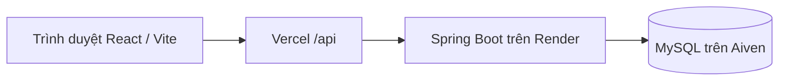

# PremierHub / PrismaXI

PremierHub là tên kỹ thuật của dự án, PrismaXI là tên trên giao diện. Đây là ứng dụng học Full-stack qua dữ liệu Premier League, đã có web tra cứu, tài khoản, Fantasy nhiều người chơi và minigame Đoán cầu thủ.

> Nội dung hiện hành được đối chiếu với code/config local ngày **10/11/2026**. Trạng thái production phải đọc theo mốc và nguồn trong [PROJECT_CONTEXT.md](PROJECT_CONTEXT.md); lượt chuẩn hóa tài liệu này không kiểm tra lại dịch vụ live hoặc phát hành mã.

- Bắt đầu hoặc chọn tài liệu theo công việc: [mục lục docs](docs/README.md).
- Làm việc với repo: [quy tắc cộng tác và quyền vận hành](AGENTS.md).
- Nhận bàn giao toàn dự án, luật và checkpoint: [PROJECT_CONTEXT.md](PROJECT_CONTEXT.md).

## Chức năng đã triển khai

| Nhóm | Khả năng hiện có |
| --- | --- |
| Tra cứu bóng đá | CLB, cầu thủ, lịch/kết quả, BXH; lọc theo mùa, tìm kiếm và trang chi tiết |
| Thống kê trận | Chỉ số cầu thủ, lịch sử theo membership ngày trận, sân 11v11 và ghế dự bị khi có dữ liệu đã xác minh |
| Tài khoản | Đăng ký/đăng nhập email, session/CSRF, Google OIDC và liên kết tài khoản có xác nhận |
| PrismaXI Fantasy 2026/27 | Builder khách; đội dự thi theo tài khoản/GW, lưu snapshot, deadline, readiness, ADMIN công bố kết quả và BXH |
| Đội hình tiêu biểu | Tính từ rating/vị trí hợp lệ đã nhập; xem từng GW và báo độ phủ dữ liệu |
| Đoán cầu thủ | Daily/luyện tập có đăng nhập, gợi ý, tiến trình, lịch sử và BXH daily |
| Console học Java | Đọc CSV mẫu, tìm CLB, vua phá lưới và tính BXH trong bộ nhớ |

Đội yêu thích, bình luận/cộng đồng, khôi phục mật khẩu và các minigame khác vẫn là hướng phát triển; không coi là đã có chỉ vì xuất hiện trong lộ trình/mockup.

## Kiến trúc và công nghệ



Đây là kiến trúc triển khai đã được ghi nhận tại [checkpoint cutover 08/10/2026](docs/render-aiven-final-cutover-2026-10-08.md), không phải bằng chứng vừa kiểm tra runtime. Railway là hạ tầng cũ; `render.yaml` là cấu hình Blueprint, không tự chứng minh đã sync/deploy.

- Backend: Java **release 21**, Spring Boot **4.1.1**, Maven **3.9.14** qua Maven Wrapper, Spring JDBC/JdbcTemplate, Security, Session JDBC và OAuth2/OIDC. Không dùng JPA/Hibernate trong code hiện tại.
- Frontend: React **19**, Vite **8**, JavaScript và Node test runner; xem phiên bản khai báo trong [package.json](frontend/package.json) và phiên bản chốt trong [lockfile](frontend/package-lock.json). Không dùng React Router.
- Local: H2; production đã chuyển sang MySQL/Aiven. Web đọc SQL qua repository/query/service, không đọc ba CSV demo để trả API.
- Console `App` đọc filesystem; hai CSV fallback đội hình được Maven/Docker đóng gói riêng. Xem [hướng dẫn lineup](docs/match-lineups-2026.md).

## Cấu trúc repo

| Đường dẫn | Vai trò |
| --- | --- |
| [backend/pom.xml](backend/pom.xml), `backend/mvnw*`, `backend/.mvn/` | Build backend, main web là `PremierHubApplication` |
| [backend/src/main/java/com/premierhub](backend/src/main/java/com/premierhub) | Web/API, JDBC, auth, Fantasy, minigame, importer và console `App` |
| [backend/src/main/resources](backend/src/main/resources) | Profile, schema local/H2 và snapshot JSON 2024 |
| [backend/src/test](backend/src/test) | Test hiện có; một số test dùng CSV đã review trong `backend/data/` |
| [backend/data](backend/data) | CSV demo, batch nhập, nguồn, bằng chứng và checkpoint theo GW |
| [backend/sql](backend/sql) | Migration/preflight MySQL đã lưu; không tự chạy khi đọc tài liệu |
| [frontend/src](frontend/src) | React, API client, builder Fantasy và minigame |
| [docs/README.md](docs/README.md) | Mục lục tài liệu theo công việc và mức độ hiện hành |

`target/`, H2, backup, secrets, `node_modules/` và `dist/` không phải nguồn để commit. Trước `clean` hoặc dọn output, xem [lưu ý backup](PROJECT_CONTEXT.md#backup-và-phạm-vi-dọn-repo): `target` có thể chứa H2/helper/bằng chứng cần giữ.

## Chạy local

Cần JDK 21 hoặc JDK mới hơn biên dịch được release 21; Node **^20.19.0 hoặc >=22.12.0** theo Vite hiện tại, cùng npm. Các ví dụ dùng PowerShell từ root repo; Linux/macOS dùng `./mvnw` và `npm` thay cho `mvnw.cmd`/`npm.cmd`.

Kiểm tra biến môi trường trước khi chạy; không dùng profile/credential production cho local. Spring không tự nạp `backend/.env.local`; một số script nguồn có bộ đọc riêng. Không bật các runner sync/import chỉ để mở web.

Terminal backend:

```powershell
cd backend
.\mvnw.cmd spring-boot:run
```

Terminal frontend:

```powershell
cd frontend
npm.cmd ci
npm.cmd run dev
```

Mở `http://localhost:5173`; Vite proxy `/api` về `http://localhost:8080`. Backend mặc định cổng 8080, có thể bị `PORT` ghi đè. Không cần đặt `VITE_API_BASE_URL` cho dev. Local chưa có dữ liệu không tự nhận bản sao production.

| Cách chạy backend, từ `backend/` | Datasource / mục đích |
| --- | --- |
| `.\mvnw.cmd spring-boot:run` | H2 file `premierhub-local` mặc định; các biến `PREMIERHUB_JDBC_URL/DB_USER/DB_PASSWORD` có thể ghi đè |
| `.\mvnw.cmd spring-boot:run "-Dspring-boot.run.profiles=auth-local"` | H2 riêng `target/auth-local`, override datasource kế thừa; xem [auth local](docs/auth-local-2026.md) |
| `.\mvnw.cmd spring-boot:run "-Dspring-boot.run.profiles=minigame-local"` | H2 riêng `target/minigame-local`, tự nạp snapshot local đã review; xem [bootstrap minigame](docs/player-guess-minigame-local-data.md) |

Không kết hợp hai profile local trên với `prod`. Bootstrap minigame là snapshot học tập, không phải đồng bộ roster production hiện tại. Google cần cấu hình riêng; đăng nhập email không đòi Google.

Kiểm tra backend qua `/actuator/health`. Nếu frontend lỗi, xem request `/api` trong Network và cổng backend trước. Danh mục contract và request mẫu: [PROJECT_CONTEXT — API](PROJECT_CONTEXT.md#9-api-chính--tra-đúng-controller-trước-khi-sửa-contract), [requests.http](requests.http); luôn kiểm `season` và ID thực tế.

## Chạy console demo Java/CSV

Từ `backend/`:

```powershell
.\mvnw.cmd compile
java -cp target/classes com.premierhub.App
```

`App` mặc định đọc `data/clubs.csv`, `data/players.csv`, `data/matches.csv` tính từ thư mục làm việc; có thể truyền thư mục khác qua đối số đầu tiên. Demo chỉ đọc CSV vào bộ nhớ và in console, không khởi động Spring/database. Ba bản sao demo resource đã được bỏ ở đợt dọn 2; các CSV filesystem vẫn giữ nguyên.

CSV demo dùng định dạng đơn giản, không hỗ trợ dấu phẩy/ngoặc kép/xuống dòng trong trường; đây là dữ liệu minh họa, không phải dữ liệu mùa thật. Lý thuyết và reader: [bài học Java/CSV](docs/phase-1.md). `spring-boot:run` hoặc `java -jar` chạy web, không chạy console demo.

## Test và build

Backend, từ `backend/`:

```powershell
.\mvnw.cmd test
.\mvnw.cmd package
```

`package` cũng chạy test. Khi test phù hợp đã được chạy riêng, có thể dùng `.\mvnw.cmd -DskipTests package` chỉ để đóng gói; không báo đó là lượt chạy test mới. Web JAR được tạo tại `target/premierhub-backend-0.1.0-SNAPSHOT.jar`.

Nếu vừa xóa/đổi resource, dùng output build mới để tránh file cũ sót trong JAR; chỉ thêm `clean` sau khi đã bảo vệ H2/backup/helper trong `target/`.

Frontend, từ `frontend/`:

```powershell
npm.cmd test
npm.cmd run build
```

`npm.cmd test` chạy `node --test`; bản web tĩnh ở `frontend/dist/`. Chọn kiểm tra theo phạm vi thay đổi. Test MySQL minigame là opt-in, dùng database test riêng; không bật bằng credential production. Kết quả test cũ phải giữ nhãn mốc/phạm vi, không suy toàn suite hiện tại đã đạt.

## Dữ liệu và vận hành

- Hai mùa tách biệt: `season=2024` là 2024/25, `season=2026` là 2026/27. Nhiều API tra cứu mặc định 2024 trong khi UI mặc định 2026; nên truyền season rõ ràng.
- Nguồn 2026: football-data.org cho lịch/tỉ số/BXH, nguồn thống kê và danh sách trận đã xác minh cho chỉ số; rating SofaScore do người dùng cung cấp. NULL không đồng nghĩa 0.
- Điểm v1 mùa 2024, điểm Fantasy 2026 theo rating và điểm minigame là ba cơ chế khác nhau. OVR không phải rating trận.
- Yêu cầu “thu thập GW” bao gồm nhập production phần đã xác minh, sau kiểm đích và backup theo [AGENTS](AGENTS.md) và [workflow GW](docs/gameweek-data-workflow.md). Mở GW, đổi deadline/roster, công bố/tái công bố kết quả và deploy cần phạm vi riêng.

| Công việc | Tài liệu chính |
| --- | --- |
| Thu thập → backup → nhập → tổng mùa/TOW/readiness | [Gameweek workflow](docs/gameweek-data-workflow.md), [bằng chứng và kết quả Fantasy](docs/fantasy-results-2026.md) |
| Hồ sơ, OVR, vị trí, lineup và tổng mùa | [Nhóm dữ liệu trong mục lục](docs/README.md#dữ-liệu) |
| Auth/Google, luật Fantasy và minigame | [Nhóm tính năng](docs/README.md#tính-năng), [phát triển local](docs/README.md#phát-triển-local) |
| Migration, release, backup/cutover và latency | [Nhóm vận hành](docs/README.md#vận-hành) |
| Trạng thái GW và số liệu đã nhập | [Checkpoint có ngày/nguồn](PROJECT_CONTEXT.md#11-checkpoint-hiện-tại--dữ-liệu-và-vòng-thi) |

Không coi code local hoặc một file Blueprint là bằng chứng đã deploy. Các lệnh nhập/release nằm trong hướng dẫn chuyên sâu để dùng khi được giao, không chạy theo một checkpoint cũ.

## Phụ lục lịch sử README

<details>
<summary>Ghi chép dữ liệu, API-Football, Railway và nhập tay được giữ từ README trước đợt dọn 3</summary>

Phần dưới được giữ nguyên để truy vết các mốc cũ, không phải hướng dẫn khởi động hiện hành. Ví dụ Railway và số liệu tại từng ngày không mô tả runtime hiện tại. Cơ chế bằng chứng v1/2024 và một số CLI nhập vẫn có thể được tham chiếu khi xử lý đúng mùa/phạm vi, sau đối chiếu code/config; quy trình 2026 hiện hành ở [mục lục dữ liệu](docs/README.md#dữ-liệu). Giới hạn 40/400 trong ghi chép cũ không phải chuẩn danh sách cầu thủ thực tế. Không chạy lại lệnh production, đổi nguồn hoặc ghi đè dữ liệu chỉ vì lệnh có trong phụ lục.

Điểm v1 theo cầu thủ–trận: ra sân 1–59 phút +1, từ 60 phút +2; mỗi bàn của thủ môn/hậu vệ/tiền vệ/tiền đạo lần lượt +10/+6/+5/+4; kiến tạo +3; thẻ vàng −1, thẻ đỏ −3. Service `MatchScoringService` áp dụng quy tắc này khi đọc chi tiết trận. Nếu một chỉ số cần thiết là `null`, khoản đó không được tính là 0: API đánh dấu `PROVISIONAL`, trả tổng các khoản đã xác định và giao diện báo **Tạm tính** hoặc **Chưa đủ dữ liệu**. Chưa tính giữ sạch lưới hay bonus; đây không phải điểm Fantasy cuối cùng.

Mười fixture Gameweek 1 (`1208021`–`1208030`) có file bằng chứng API-Football rút gọn trong `data/fixture-<id>-evidence.json`. Lệnh nhập một lần lưu ID bàn thắng/kiến tạo, người vào/ra sân và đội hình vào `fixture_score_evidence` theo khóa fixture ID. Trước khi lưu và suy luận, backend kiểm tra 40 ID, 11 đá chính + 9 dự bị mỗi đội, người vào sân có phút trong H2, bàn thắng/kiến tạo khớp dữ liệu dương và sự kiện bàn thắng khớp tỉ số. Bàn thường và bàn phạt đền cộng vào thống kê bàn thắng cầu thủ. Với phản lưới, cầu thủ phải thuộc đội đối phương của đội được ghi bàn; bàn chỉ cộng vào tỉ số đội hưởng, không cộng hay trừ điểm bàn thắng cho cầu thủ trong v1. Nếu kiểm tra sai, lệnh nhập dừng trước khi lưu và giữ nguyên bản ghi bằng chứng cũ nếu có. Khi đúng, `inferred.minutes/goals/assists` chứa riêng giá trị suy luận; các trường gốc trong `fixture_player_stats` và JSON chi tiết vẫn giữ `null`. Chạy lại cùng file cập nhật một dòng bằng chứng, không tạo dòng trùng. Lệnh local từ `backend/` (chọn file tương ứng):

```powershell
.\mvnw.cmd -q -DskipTests package
java -jar target/premierhub-backend-0.1.0-SNAPSHOT.jar --spring.main.web-application-type=none --premierhub.fixture-evidence.enabled=true --premierhub.fixture-evidence.file=data/fixture-1208021-evidence.json
java -jar target/premierhub-backend-0.1.0-SNAPSHOT.jar --spring.main.web-application-type=none --premierhub.fixture-evidence.enabled=true --premierhub.fixture-evidence.file=data/fixture-1208022-evidence.json
# Tương tự, chọn file data/fixture-<id>-evidence.json của các trận 1208023–1208030.
```

Lựa chọn CLB trong bộ lọc lấy từ Club API. Khi chạy bằng `npm.cmd run dev`, frontend luôn gọi `/api/...` qua Vite proxy, dù `VITE_API_BASE_URL` có được đặt trong môi trường local.

Nếu trang báo lỗi API, mở `http://localhost:8080/actuator/health` rồi thử trực tiếp `/api/clubs`, `/api/players`, `/api/matches` hoặc `/api/standings` trên cùng host. Nếu không phản hồi, kiểm tra terminal backend, JDK và biến `PORT` (local cần cổng 8080 để khớp proxy). Nếu backend trả dữ liệu nhưng frontend vẫn lỗi, xem tab Network trong Developer Tools để kiểm tra request `/api/...`, rồi xác nhận Vite đang chạy đúng cổng/đúng thư mục. Chạy `npm.cmd run build` trong `frontend/` để kiểm tra bản build; `frontend/dist/` và `frontend/node_modules/` được Git bỏ qua.

Minigame 2026/27 đã có tab frontend theo mockup và nối API daily/luyện tập/BXH. Để chạy local, dùng profile backend `minigame-local`, mở `http://localhost:5173/#minigame`; xem [hướng dẫn và kết quả kiểm tra](docs/player-guess-minigame-frontend.md). Profile tự nạp snapshot đã chốt gồm 534 cầu thủ/20 CLB vào H2 riêng, có 364 đáp án đủ dữ liệu. Xem [nguồn dữ liệu và cơ chế nạp local](docs/player-guess-minigame-local-data.md).

Minigame Đoán cầu thủ đã bật trên [production](https://premierhub.vercel.app/#minigame): MySQL có đủ bảy bảng, frontend/backend cùng SHA, pool thật 2026/27 có 364 đáp án hợp lệ tại ngày phát hành. Backup đã thử restore, migration chạy lại an toàn, kiểm tra API/Chrome desktop/mobile đạt; người dùng xác nhận chơi bằng tài khoản thật và reload giữ đúng tiến trình. Xem [biên bản production 08/10](docs/player-guess-minigame-production-2026-10-08.md) và [hướng dẫn phát hành](docs/player-guess-minigame-release.md); không dùng profile/DB/bootstrap H2 local trên Railway.

## Deploy frontend lên Vercel, dùng backend Railway

Đã chuẩn bị phương án chuyển backend sang Render Free + Aiven MySQL Free, giữ frontend/domain Vercel: [cấu hình, danh sách biến và quy trình chuyển toàn database](docs/render-aiven-migration.md). Đây là bản chuẩn bị, chưa đổi proxy/kết nối production hoặc dừng Railway.

Frontend là ứng dụng Vite tĩnh; backend Spring Boot tiếp tục chạy trên Railway. Trước khi triển khai, kiểm tra URL backend Railway công khai qua `https://<railway-domain>/actuator/health` và `https://<railway-domain>/api/clubs`. URL này là **origin** (giao thức + host, có thể có cổng), không chứa `/api` hay đường dẫn khác. Repo không lưu sẵn domain Railway hoặc Vercel.

1. Sau khi review và đưa commit frontend/backend này lên GitHub, vào [Vercel Dashboard](https://vercel.com/new), chọn **Add New → Project**, kết nối GitHub nếu chưa kết nối. Khi cấp quyền cho Vercel GitHub App, chọn đúng repo riêng tư `EPL---PERSONAL` (hoặc chọn **Only select repositories** rồi cấp quyền cho repo đó), sau đó **Import** repo.
2. Trong **Configure Project**, chọn **Framework Preset: Vite** và **Root Directory: `frontend`** bằng nút **Edit**. **Build Command: `npm run build`**, **Output Directory: `dist`** (tính từ `frontend/`). Để Install Command mặc định của Vercel; dependency được cài theo `frontend/package-lock.json`. Không chọn `backend/` hay thư mục gốc làm Root Directory.
3. Trong **Environment Variables**, thêm `VITE_API_BASE_URL=https://<railway-domain>` cho **Production**; thêm cho **Preview** nếu muốn dùng bản preview. Không thêm `/api` ở cuối. Dấu `/` cuối URL vẫn được code xử lý. Biến `VITE_` được Vite đóng vào JavaScript gửi cho trình duyệt, nên chỉ đặt URL công khai, **không đặt token/mật khẩu**. Bấm **Deploy**.
4. Lấy domain production trong **Project → Domains** hoặc deployment production, ví dụ `https://<project>.vercel.app`. Trên Railway, vào service backend → **Variables**, đặt `PREMIERHUB_CORS_ALLOWED_ORIGINS=https://<project>.vercel.app`. Nếu cần nhiều domain, phân cách bằng dấu phẩy, ví dụ `https://<project>.vercel.app,https://<custom-domain>`. Đây là danh sách origin chính xác, không có `/` cuối và không dùng `*`. Deploy lại backend nếu Railway chưa tự tạo deployment khi biến thay đổi.
5. Sau khi backend Railway chạy với biến mới, mở domain Vercel và thử cả bốn trang: `/#clubs`, `/#players`, `/#matches`, `/#standings`. Thử tìm/lọc và kiểm tra tab **Network**: request phải đi tới `https://<railway-domain>/api/...`, trả JSON và có header `Access-Control-Allow-Origin` bằng đúng domain Vercel. Nếu đổi `VITE_API_BASE_URL` trên Vercel, cần tạo **deployment mới** vì biến được đóng vào bản build.

Backend luôn cho phép `http://localhost:5173` và `http://127.0.0.1:5173` khi gọi trực tiếp; local thông thường dùng Vite proxy. Nếu Vite chạy trên cổng khác và muốn gọi trực tiếp backend, thêm origin local đó vào `PREMIERHUB_CORS_ALLOWED_ORIGINS`.

Vercel tạo domain Preview riêng; domain này có thể khác domain Production. Muốn Preview gọi API, thêm **origin Preview cụ thể** vào `PREMIERHUB_CORS_ALLOWED_ORIGINS` trên Railway rồi redeploy backend. Nếu URL Preview thay đổi theo mỗi deployment, dùng một domain Preview/branch ổn định hoặc cập nhật từng origin cần thử. Không dùng `*.vercel.app` hay `*` để mở CORS cho mọi site.

Nếu trang production báo lỗi API: (1) kiểm tra trực tiếp `https://<railway-domain>/actuator/health` và `/api/clubs`; (2) trong Network xác nhận request dùng đúng Railway URL và không bị lỗi mixed content; (3) kiểm tra `Origin` của request có trong `PREMIERHUB_CORS_ALLOWED_ORIGINS` và response có `Access-Control-Allow-Origin`; (4) kiểm tra cả Vercel deployment mới và Railway deployment mới đã hoàn tất. Có thể kiểm tra CORS bằng lệnh sau, thay các domain bằng URL thật:

```powershell
curl.exe -i -H "Origin: https://<project>.vercel.app" "https://<railway-domain>/api/clubs"
curl.exe -i -H "Origin: https://other.example" "https://<railway-domain>/api/clubs"
```

Lệnh đầu phải có `Access-Control-Allow-Origin: https://<project>.vercel.app`; lệnh thứ hai phải bị từ chối và không có header này. Nguồn tham khảo: [Vercel monorepo](https://vercel.com/docs/monorepos), [Vercel GitHub](https://vercel.com/docs/git/vercel-for-github), [Vercel build](https://vercel.com/docs/builds/configure-a-build), [Vite env](https://vite.dev/guide/env-and-mode), [Spring MVC CORS](https://docs.spring.io/spring-framework/reference/web/webmvc-cors.html).

## Nguồn dữ liệu 2024/25 và giới hạn Free

PremierHub dùng API-Football với `league=39`, `season=2024`. Lần kiểm chứng thực tế cho thấy 20 đội, 10 trận vòng 1, 20 dòng BXH, thống kê mùa cầu thủ và 40 dòng thống kê cầu thủ của một trận đã kết thúc. `GET /players?league=39&season=2024` báo 57 trang nhưng gói Free từ chối `page=4` vì **mỗi truy vấn chỉ truy cập tối đa 3 trang**. Lệnh đồng bộ chia truy vấn theo CLB; đội nào có hơn 3 trang vẫn thiếu một phần cầu thủ. Job ghi `truncatedClubIds` và `complete=false` trong trường hợp này. Không dùng dữ liệu giả để lấp chỗ thiếu. Những trường như bàn thắng, kiến tạo, phút thi đấu hoặc rating có thể là `null` trong response; database giữ `NULL` cho thống kê theo trận. Màn hình tổng mùa hiển thị `0` cho bàn thắng/kiến tạo thiếu để giữ cấu trúc JSON cũ.

Ảnh chụp H2 local ngày 25/09/2026, **không chạy đồng bộ thêm**: 20 CLB, 10 trận Gameweek 1, 400 bản ghi thống kê cầu thủ–trận và 20 dòng BXH cuối mùa (38 trận/đội). Bảng `players` có 432 cầu thủ do thống kê trận cung cấp, nhưng trang `/api/players` chỉ trả **63 dòng thống kê mùa cầu thủ–CLB** từ ba trang đầu của truy vấn toàn giải. Bournemouth, Brentford và Crystal Palace hiện chưa có dòng thống kê mùa nào trong H2. Trang Cầu thủ vì vậy chưa đủ dữ liệu để chọn đội Fantasy; kết quả lọc rỗng có thể chỉ là dữ liệu chưa được tải. BXH hiện có là BXH cuối mùa, không phải BXH sau Gameweek 1.

Đặt `API_FOOTBALL_KEY` trong môi trường backend hoặc file Git-ignored `backend/.env.local` với một dòng `API_FOOTBALL_KEY=...`. Key chỉ được đọc bởi backend/job, không đặt vào `VITE_`. Kiểm chứng theo Gameweek:

```powershell
cd backend
node scripts/verify-api-football.mjs 2024 1
```

Script kiểm tra đội, trận, BXH, trang cầu thủ đầu và thống kê cầu thủ của trận đã kết thúc, tối đa 8 request, cách nhau 6,5 giây. Không in key hoặc response đầy đủ. Trước đây Free đã từ chối mùa 2026/27; ứng dụng này cố ý dùng mùa 2024/25 có thể truy cập.

## Đồng bộ từng Gameweek và database

Chạy từ `backend/` sau khi đã build JAR. Lệnh sau đồng bộ vòng 1 và thoát; có thể chạy lại an toàn:

```powershell
.\mvnw.cmd -q -DskipTests package
java -jar target/premierhub-backend-0.1.0-SNAPSHOT.jar --spring.main.web-application-type=none --premierhub.sync.enabled=true --premierhub.sync.season=2024 --premierhub.sync.gameweek=1 --premierhub.sync.budget=70
```

Vòng tiếp theo: đổi `--premierhub.sync.gameweek=2`. Mỗi lần chạy chỉ tải một Gameweek; nếu hết ngân sách request, job giữ checkpoint và in `complete=false`, chạy lại sau khi quota được cấp. `--premierhub.sync.budget` giới hạn tối đa 90 request/lần, mặc định 70; job còn giữ tối thiểu 5 request trong quota ngày và giãn các request 6,5 giây. Job lấy lại danh sách trận của Gameweek để phát hiện trạng thái/tỉ số thay đổi, nhưng bỏ qua thống kê trận đã có nếu fingerprint trận chưa đổi. Nếu nhà cung cấp sửa thống kê cầu thủ mà không đổi trận, chạy cùng Gameweek với `--premierhub.sync.refresh-stats=true`. Muốn cập nhật lại thống kê tổng mùa đã lưu, thêm `--premierhub.sync.refresh-players=true` khi còn quota. Không cần chạy lại toàn bộ mùa.

Local dùng H2 file `backend/premierhub-local.mv.db`, giữ dữ liệu qua lần chạy. Schema nằm trong `backend/src/main/resources/schema.sql`, tự tạo bảng còn thiếu lúc khởi động. Các bảng chính là `seasons`, `clubs`, `season_clubs`, `players`, `player_season_stats`, `fixtures`, `standings`, `fixture_player_stats`, `sync_states`. ID đội, cầu thủ và trận dùng ID của nhà cung cấp. Thống kê cầu thủ theo trận có khóa `(fixture_id, player_id)`, lưu phút, bàn thắng, kiến tạo, thẻ, rating và các chỉ số sẵn có khác, cùng JSON gốc để xử lý thêm về sau. Chi tiết trận đã có điểm v1; giao diện Replay GW1 được mô tả bên dưới.

### Railway

Không dùng H2 file trên Railway vì storage của web service có thể không bền qua deploy. Trên tài khoản Railway, bạn cần tự thêm MySQL (xem chi phí/gói dịch vụ trước khi tạo), rồi đặt các biến sau cho **web service** và **Cron service** của backend:

- `SPRING_PROFILES_ACTIVE=prod`
- `PREMIERHUB_JDBC_URL=jdbc:mysql://<MYSQLHOST>:<MYSQLPORT>/<MYSQLDATABASE>` (điền bằng Railway reference variables tới MySQL cùng project)
- `PREMIERHUB_DB_USER=<MYSQLUSER>` và `PREMIERHUB_DB_PASSWORD=<MYSQLPASSWORD>` (dùng reference variables, không ghi mật khẩu vào Git)
- `API_FOOTBALL_KEY=<key>` chỉ cho Cron service; web service không cần key để tra cứu
- Giữ `PREMIERHUB_CORS_ALLOWED_ORIGINS` cho domain Vercel như phần trên.

Nếu về sau dùng Cron để đồng bộ vòng khác, build cùng source `backend/` và đặt Start Command như lệnh Java ở trên (thay Gameweek và giữ `--spring.main.web-application-type=none`), đặt Cron Schedule theo UTC tùy ngày muốn chạy. Job phải chạy xong rồi thoát, không chạy scheduler trong web service Serverless. Xem log `SYNC ...` để biết request, Gameweek và checkpoint. Để đưa bản GW1 hiện có lên production, dùng **snapshot** bên dưới, không chạy đồng bộ API-Football.

Sau deploy, thử `https://<railway-domain>/api/clubs?season=2024`, `/api/players?season=2024`, `/api/matches?season=2024&matchweek=1`, `/api/standings?season=2024`; rồi mở bốn trang trên Vercel. Nếu API trả mảng rỗng, kiểm tra Cron đã dùng cùng database với web service và đã in kết quả sync.

## Đưa bản tra cứu Gameweek 1 mùa 2024/25 lên database

Snapshot `backend/src/main/resources/data/gw1-2024-snapshot.json` được xuất từ H2 local đã kiểm chứng; ứng dụng production đọc snapshot đóng trong JAR, **không cần file H2 local hoặc API-Football key**. Snapshot có 20 CLB, 432 hồ sơ cầu thủ, 63 dòng thống kê mùa, 10 trận, 20 dòng BXH cuối mùa, 400 dòng cầu thủ–trận và 10 bằng chứng tính điểm. Trang Cầu thủ chỉ hiển thị 63 dòng thống kê mùa hiện có; dữ liệu mùa này chưa đầy đủ. Giá trị `NULL` của provider được giữ nguyên. Trang Lịch đấu ghi rõ GW1 2024/25; BXH ghi rõ đó là **BXH cuối mùa 2024/25**, không phải BXH sau GW1.

Trang `/#fantasy` dùng roster và OVR FC 27 của mùa 2026/27 tại ngày `2026-10-02`. Người chơi chọn 11 cầu thủ theo một trong bốn sơ đồ, tối đa ba người mỗi CLB; nút **Xem kết quả** hiển thị tổng OVR đội hình. Đội hình lưu trong `localStorage`, không cần tài khoản. Cầu thủ thiếu OVR và Max Dowman (OVR 72 là mức ước tính của PremierHub) vẫn có trong danh sách nhưng chưa thể chọn Fantasy.

Nhập vào một database **đã tạo hoặc đang dùng** (không xóa bảng/dòng cũ). Dùng đúng JDBC URL và credentials của database mà **web service Railway** sử dụng:

```powershell
cd backend
.\mvnw.cmd -q -DskipTests package
java -jar target/premierhub-backend-0.1.0-SNAPSHOT.jar --spring.main.web-application-type=none --premierhub.snapshot.mode=import
```

Lệnh đọc `PREMIERHUB_JDBC_URL`, `PREMIERHUB_DB_USER`, `PREMIERHUB_DB_PASSWORD` từ môi trường, in số dòng mới ở mỗi bảng cùng `verifiedFixtures=10`, rồi thoát. Trên Railway, đặt tạm **Pre-deploy Command** cho backend service trong environment `production`:

```text
java -jar /app/target/premierhub-backend-0.1.0-SNAPSHOT.jar --spring.main.web-application-type=none --premierhub.snapshot.mode=import
```

Pre-deploy chạy trong private network với biến của backend, trước khi web service nhận traffic; nó ghi vào MySQL, không dùng volume của web container. Backend cần `SPRING_PROFILES_ACTIVE=prod` và ba biến `PREMIERHUB_JDBC_URL`, `PREMIERHUB_DB_USER`, `PREMIERHUB_DB_PASSWORD` tham chiếu tới service MySQL. Kiểm tra log `GW1 SNAPSHOT ... verifiedFixtures=10`; chạy lại deployment phải in số dòng mới bằng `0`. **Gỡ Pre-deploy Command sau khi đã kiểm tra**, để lần deploy sau không phụ thuộc snapshot lịch sử. Không đặt API key trong frontend hoặc Git. Nếu một bản ghi cùng ID đã có nhưng nội dung khác, lệnh dừng và rollback thay vì ghi đè dữ liệu production; các bảng khác và mùa khác không bị xóa.

Sau khi job hoàn tất, kiểm tra `/api/clubs?season=2024` (20 dòng), `/api/players?season=2024` (63 dòng), `/api/matches?season=2024&matchweek=1` (10 dòng), `/api/standings?season=2024` (20 dòng), và `/api/matches/1208021/details?season=2024` đến `1208030` (`VERIFIED`, 40/40 `COMPLETE` mỗi trận). Kiểm tra bốn trang và mở chi tiết các trận tại domain Vercel; Vercel cần root directory `frontend`, build `npm run build`, output `dist` và `VITE_API_BASE_URL` là origin Railway công khai. Nếu web còn hiển thị dữ liệu cũ, kiểm tra Vercel deployment đã lấy commit mới và cả job lẫn web đang kết nối cùng database.

## Quy tắc bảng xếp hạng

Web API đọc hạng/điểm/hiệu số từ database mỗi request: API-Football cho 2024/25, bảng TOTAL của football-data.org cho 2026/27. Bộ tính BXH từ trận (thắng 3, hòa 1) chỉ còn trong console demo và test Java cũ.

Các ví dụ học tập đã hoàn thiện và test tương ứng nằm trong [docs/LEARNING_TASKS.md](docs/LEARNING_TASKS.md).

## Dữ liệu cơ bản 2026/27 từ football-data.org

Kiểm chứng ngày 26/09/2026 bằng đúng **3 GET** API v4, cùng `season=2026`: `PL/teams` trả HTTP 200, 20 đội; `PL/matches` trả HTTP 200, 380 trận (50 FINISHED, 330 TIMED); `PL/standings` trả HTTP 200, 20 dòng TOTAL. Mùa trong response bắt đầu `2026-08-21`, kết thúc `2027-05-30`. Không thiếu ID đội/trận, vòng, giờ UTC hoặc chỉ số BXH bắt buộc. 330 trận TIMED có hai tỉ số `null`; cả 50 trận FINISHED có tỉ số. Không dùng squad hoặc thống kê cầu thủ từ nguồn này.

Đặt `FOOTBALL_DATA_API_KEY` trong môi trường của tiến trình backend hoặc thêm dòng `FOOTBALL_DATA_API_KEY=<token>` vào `backend/.env.local` (đã Git ignore). Client ưu tiên biến môi trường, rồi tự đọc file `.env.local` khi chạy từ thư mục `backend/`; không cần Spring tự nạp dotenv. Không dùng `VITE_` và không truyền token trong tham số dòng lệnh.

Chạy thủ công từ `backend/` (các tham số database bên dưới cố định vào **H2 local**, không dùng Railway MySQL):

```powershell
.\mvnw.cmd -q -DskipTests package
java -jar target/premierhub-backend-0.1.0-SNAPSHOT.jar --premierhub.football-data.enabled=true --premierhub.football-data.season=2026 --spring.main.web-application-type=none --spring.profiles.active=local "--spring.datasource.url=jdbc:h2:file:./premierhub-local;MODE=MySQL;DATABASE_TO_LOWER=TRUE" --spring.datasource.username=sa --spring.datasource.password=
```

Mỗi lần chạy gọi đúng ba endpoint ở trên, cách nhau ít nhất 6,5 giây, không retry. Toàn bộ response phải qua kiểm tra mùa, đủ 20 đội/380 trận/20 dòng TOTAL và các trường bắt buộc trước khi ghi trong một transaction. Lỗi HTTP 401/403/429, response thiếu/sai mùa hoặc xung đột ID làm lệnh thất bại; dữ liệu trước đó được giữ nguyên. Lệnh in tổng số dòng và số đội/trận thêm mới rồi thoát; chạy lại cập nhật lịch, trạng thái, tỉ số và BXH mà không tạo trùng. Chỉ hỗ trợ mùa 2026 trong bước này.

Để dùng lại ba response đã kiểm chứng mà không gọi API, thêm `--premierhub.football-data.input-dir=target` vào lệnh trên. Thư mục phải có `football-data-2026-teams.json`, `football-data-2026-matches.json`, `football-data-2026-standings.json`. Đây là cache local trong thư mục Git ignore, không đóng vào JAR hoặc commit. Đường nhập cache vẫn kiểm tra toàn bộ dữ liệu như đường API.

Schema chỉ thêm `football_data_teams` và `football_data_fixtures`, không đổi/xóa bảng cũ. Mỗi bảng lưu provider ID và internal ID; internal ID của đội/trận mới là `1_000_000_000 + provider ID`, có kiểm tra va chạm trước khi dùng. Không ghép đội theo tên. Cùng CLB thực tế có thể có hai internal ID ở hai nguồn; muốn gộp sau này cần ánh xạ được kiểm chứng. Premier League của football-data.org (`2021`/`PL`) được ánh xạ rõ vào league nội bộ hiện có `39`.

`football_data_fixtures.kickoff_utc` lưu giờ ISO-8601 UTC và `provider_status` lưu trạng thái gốc (ví dụ TIMED). Bảng `fixtures` giữ trạng thái chung (TIMED → SCHEDULED), ngày UTC và tỉ số nullable. JSON API cũ giữ nguyên trường `date` chỉ có ngày, chưa thêm giờ vào response. Thành phố CLB mới để NULL, không suy đoán từ địa chỉ. Không sinh player, player-season-stat, player-match-stat, bằng chứng hoặc điểm Fantasy cho 2026.

Sau khi khởi động backend local với cùng H2, kiểm tra:

- `/api/clubs?season=2026`: 20 đội.
- `/api/matches?season=2026&round=1`: 10 trận; `matchweek=1` vẫn được hỗ trợ. Nếu cùng gửi hai tên lọc với giá trị khác nhau thì trả 400.
- `/api/matches?season=2026`: 380 trận, 330 trận chưa có tỉ số tại thời điểm kiểm chứng.
- `/api/standings?season=2026`: 20 dòng TOTAL hiện tại.
- `/api/players?season=2026`: mảng rỗng trước khi nhập danh sách thủ công; chi tiết trận 2026 chưa có thống kê cầu thủ.
- Các API `season=2024` vẫn dùng dữ liệu/điểm cũ.

Ngày 27/09/2026 đã nhập cache kiểm chứng vào Railway MySQL production: 20 CLB, 380 trận (50 `FINISHED`) và 20 dòng BXH; 330 trận chưa kết thúc giữ tỉ số `NULL`. Nhập lại tạo thêm 0 CLB và 0 trận. Schema chỉ tạo thêm hai bảng ánh xạ, không xóa bảng cũ; bản sao lưu SQL trước khi nhập được lưu local ngoài Git. Không thiết lập Cron hoặc Pre-deploy Command để tự nhập lại. Thống kê cầu thủ–trận 2026 sẽ nhập thủ công ở bước sau.

Frontend đã có bộ chọn mùa **2024/25 / 2026/27** ở CLB, Lịch đấu và BXH. Lựa chọn mùa được giữ khi chuyển giữa ba trang trong phiên hiện tại; đổi mùa sẽ xóa bộ lọc và đóng chi tiết trận cũ. API CLB (kể cả tìm kiếm), lịch đấu, chi tiết trận và BXH nhận đúng `season`. Lịch đấu mặc định GW1; có thể chọn tất cả vòng đã lưu hoặc GW1–38 cho 2026/27 (2024/25 mới có GW1).

BXH ghi rõ **cuối mùa 2024/25** hoặc **hiện tại 2026/27 theo lần đồng bộ gần nhất**. Các trang dữ liệu 2026/27 có attribution và liên kết football-data.org. Trận chưa đá không hiển thị tỉ số giả. Trang Cầu thủ hỗ trợ cả hai mùa; Fantasy chỉ dùng 2026/27.

Kiểm tra local bằng backend đọc H2 ở cổng 8080 và `npm run dev` trong `frontend/`, mở `http://localhost:5173/`. Thử chuyển mùa trên ba trang: 2026/27 có 20 CLB, GW1 có 10 trận, BXH có 20 đội; chọn GW6 để xem trận chưa đá. Chuyển về 2024/25 và mở chi tiết GW1 để thấy dữ liệu đã xác minh. Sau khi phát hành backend và frontend, kiểm tra lại các URL production `/api/clubs?season=2026`, `/api/matches?season=2026&matchweek=1`, `/api/matches?season=2026&matchweek=6`, `/api/standings?season=2026` và trang `/#fantasy`. Frontend không tự gọi nhà cung cấp hoặc đồng bộ database.

Tài liệu chính thức: [Competition v4 và bộ lọc mùa](https://docs.football-data.org/general/v4/competition.html), [trạng thái và header X-Auth-Token](https://docs.football-data.org/general/v4/lookup_tables.html), [Free 10 request/phút và ý nghĩa null](https://docs.football-data.org/general/v4/policies.html).

## Danh sách cầu thủ 2026/27 nhập thủ công

Đợt mở rộng roster ngày 30/09/2026 được ghi tại
[`backend/data/roster-2026-09-30/README.md`](backend/data/roster-2026-09-30/README.md),
gồm bốn batch, đối chiếu ID với production, nguồn FPL và danh sách cần xác nhận.
CSV reader chấp nhận ID dương đã tồn tại trong database (kể cả ID provider từ mùa 2024/25);
chỉ **ID mới** bắt buộc thuộc dải `2000000000..2099999999`.
Khi tái sử dụng ID cũ, giữ nguyên tên đang lưu và kiểm tra danh tính trước khi nhập.
Importer không tự ghép cầu thủ chỉ dựa vào tên.

Mẫu trống ở `backend/data/manual-players-2026-template.csv`. Tạo file UTF-8 với đúng header và một dòng cho mỗi cặp cầu thủ–CLB:

```csv
season,club_id,player_id,name,fantasy_position,start_date,end_date
2026,1000000057,2000000001,Tên cầu thủ đã kiểm chứng,GK,2026-08-01,
```

Ví dụ trên chỉ minh họa **định dạng**, không xác nhận cầu thủ đó thuộc Arsenal và không được nhập nguyên mẫu vào dữ liệu thật. `club_id` lấy từ `GET /api/clubs?season=2026` trên backend đọc cùng database. `player_id` giữ ổn định qua các mùa và lần chuyển CLB: tái sử dụng ID đã có trong database; chỉ cấp ID thủ công mới trong khoảng `2000000000..2099999999` cho người chưa tồn tại. Không tạo ID từ tên. Vị trí Fantasy chỉ nhận `GK`, `DEF`, `MID`, `FWD`; API giữ cách ghi hiện có `GOALKEEPER`, `DEFENDER`, `MIDFIELDER`, `FORWARD`. Tên không được chứa dấu phẩy, dấu nháy kép hoặc tab vì file CSV này không hỗ trợ trường được quote. File phải có ít nhất một dòng dữ liệu.

`start_date` bắt buộc theo `YYYY-MM-DD`; `end_date` để trống nếu vẫn thuộc CLB. Khoảng hiệu lực là **[start_date, end_date)**: ngày kết thúc không còn thuộc CLB cũ và có thể là ngày bắt đầu ở CLB mới. Khi chuyển đội, giữ **cùng `player_id` và `name`**, nhập lại dòng CLB cũ với `end_date` được điền và thêm dòng CLB mới với `start_date` đúng ngày đó. Phải nhập cả hai dòng trong cùng file nếu dòng cũ đang mở; chỉ thêm dòng mới sẽ bị từ chối vì hai khoảng chồng nhau. Có thể nhập thêm đợt mới cho cùng CLB nếu ngày bắt đầu khác và các khoảng không chồng nhau. Khóa thời gian là `(season, player_id, club_id, start_date)`. Lệnh kiểm tra cả các khoảng đã lưu trước khi ghi, từ chối trùng/chồng lấn, ID dùng cho tên khác, vị trí khác của cặp cầu thủ–CLB, CLB không thuộc mùa 2026/27 và vị trí sai. Lệnh không xóa lịch sử hoặc ghi đè thống kê.

`GET /api/players?season=2026` trả CLB có hiệu lực **hôm nay theo UTC**; thêm `asOf=2026-09-14` để xem CLB vào một ngày cũ, ví dụ `GET /api/players?season=2026&asOf=2026-09-14`. `GET /api/players/{id}?season=2026&asOf=...` dùng cùng quy tắc. Ngày trước khi cầu thủ gia nhập hoặc sau khi đã rời CLB mà chưa có dòng mới sẽ không trả cầu thủ đó. API mùa 2024/25 giữ nguyên.

Nếu H2 local đã có dòng cầu thủ 2026/27 nhập theo CSV cũ chưa có ngày, cần nhập lại các dòng đó bằng định dạng mới với ngày đã kiểm chứng. Không thể tự suy ra ngày từ dòng cũ; API 2026 chỉ đọc các khoảng thời gian đã nhập.

Sau khi tự kiểm chứng và điền file `backend/data/manual-players-2026.csv`, chạy **chỉ trên H2 local** từ `backend/`:

```powershell
.\mvnw.cmd -q -DskipTests package
java -jar target/premierhub-backend-0.1.0-SNAPSHOT.jar --premierhub.manual-roster.enabled=true --premierhub.manual-roster.file=data/manual-players-2026.csv --spring.main.web-application-type=none --spring.profiles.active=local "--spring.datasource.url=jdbc:h2:file:./premierhub-local;MODE=MySQL;DATABASE_TO_LOWER=TRUE" --spring.datasource.username=sa --spring.datasource.password=
```

Lệnh kiểm tra cả file trước khi ghi, chạy một transaction rồi thoát; log `MANUAL_ROSTER` cho biết số cầu thủ, cặp cầu thủ–CLB và khoảng thời gian mới/cập nhật. Nhập lại file giống hệt sẽ báo `playersInserted=0 membershipsInserted=0 intervalsInserted=0 intervalsUpdated=0`. `goals` và `assists` là JSON `null` khi chưa có thống kê, không phải `0`. File giả `backend/src/test/resources/manual-players-2026-example.csv` chỉ dành cho H2 test; không nhập vào H2 dùng để tra cứu hoặc MySQL production. Bước roster này chưa nhập thống kê theo trận hoặc điểm Fantasy 2026/27 vào Railway.

## CSV thống kê cầu thủ–trận 2026/27 (nhập tay)

Sao chép `backend/data/manual-match-stats-2026-gameweek-template.csv` thành **một file CSV UTF-8 cho cả Gameweek**. Template chỉ có header; điền các dòng đã kiểm chứng trước khi chạy importer:

```csv
season,fixture_id,player_id,status,rating,minutes,goals,assists,yellow_cards,red_cards
```

Mỗi dòng là **một cặp `(fixture_id, player_id)`**. Lấy `fixture_id` từ `/api/matches?season=2026&round=...` và `player_id` từ roster đã nhập; không suy ID từ tên. Một cầu thủ có thể xuất hiện ở hai fixture khác nhau trong cùng file, nhưng cùng cặp không được lặp. `status` chỉ nhận `PLAYED` hoặc `DID_NOT_PLAY`. `rating` là số thập phân 0–10, tối đa hai chữ số sau dấu chấm; để trống nếu chưa biết. Các chỉ số đếm cũng để trống nếu chưa biết, **không tự điền 0**. `PLAYED` cho phép để trống phút nếu nguồn chưa nêu, nhưng nếu điền phải lớn hơn 0. `DID_NOT_PLAY` chỉ dùng khi nguồn xác nhận cầu thủ không vào sân: `rating` trống, `minutes=0`, các chỉ số khác trống hoặc 0. Nếu nguồn không xác nhận tình trạng ra sân, chưa đưa cầu thủ đó vào file.

Quy trình ngắn: lấy các fixture `FINISHED` của vòng từ `/api/matches?season=2026&matchweek=N`; đối chiếu `player_id` và khoảng thuộc CLB vào ngày từng trận, **liệt kê cầu thủ thiếu roster để bổ sung trước**, không tự cấp ID. Người dùng cung cấp rating hoặc ảnh rating; đội hình, phút, bàn, kiến tạo và thẻ được đối chiếu từ nguồn công khai trước khi điền. Giữ trống chỉ số chưa biết, không tự gán `DID_NOT_PLAY`. CSV không lưu đường dẫn nguồn hay thời điểm kiểm tra, và không hỗ trợ dấu nháy kép hoặc tab. File giả ở `backend/src/test/resources/manual-match-stats-2026-example.csv` chỉ dùng cho H2 test.

Importer nhận nhiều `fixture_id` trong một file, không đặt giới hạn số trận; một Gameweek Premier League thường có 10 trận. Mỗi dòng được kiểm tra với fixture Premier League `season=2026` đã `FINISHED` và khoảng thuộc CLB trong `manual_player_memberships` vào **ngày trận đấu**. Lỗi đầu tiên ghi số dòng, `fixture_id` và `player_id`; toàn batch dùng một transaction nên một dòng lỗi làm cả file không được ghi. Dữ liệu nhập tay vào bảng riêng `manual_fixture_player_stats`; không sửa `fixture_player_stats` thô hoặc điểm v1 của 2024/25. Với dòng `PLAYED`, `fantasy_points` bằng `rating` nếu đã có rating, nếu chưa có thì `NULL`; với `DID_NOT_PLAY` đã được xác nhận, điểm là `0`. API `/api/players/{id}/matches?season=2026` đọc rating và chỉ số nhập tay ở `stats`; `stats.score` v1 vẫn là `null`.

Để thử trên **bản sao H2 cô lập**, dùng executable JAR đã build sau lần đổi mã gần nhất. Tắt backend local, tạo file CSV đã điền rồi chạy từ `backend/` (ví dụ GW6):

```powershell
Copy-Item -LiteralPath premierhub-local.mv.db -Destination target/manual-match-GW6.mv.db
$env:PREMIERHUB_JDBC_URL='jdbc:h2:file:./target/manual-match-GW6;MODE=MySQL;DATABASE_TO_LOWER=TRUE'
java -jar target/premierhub-backend-0.1.0-SNAPSHOT.jar --premierhub.manual-match-stats.enabled=true --premierhub.manual-match-stats.file=data/manual-match-stats-2026-GW6.csv
```

Lệnh chạy một lần rồi thoát; log `MANUAL_MATCH_STATS ... inserted=N`. Chạy lại **cùng file** phải báo `inserted=0`. Dòng đã lưu nhưng khác nội dung bị báo xung đột, không ghi đè. Chỉ build/test một lần khi đổi mã, không lặp theo từng CSV. Không đặt lệnh nhập làm Pre-deploy Command hoặc cron.

</details>
